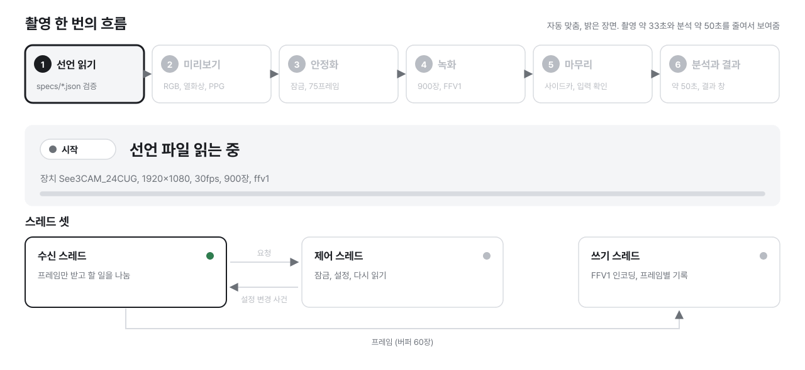
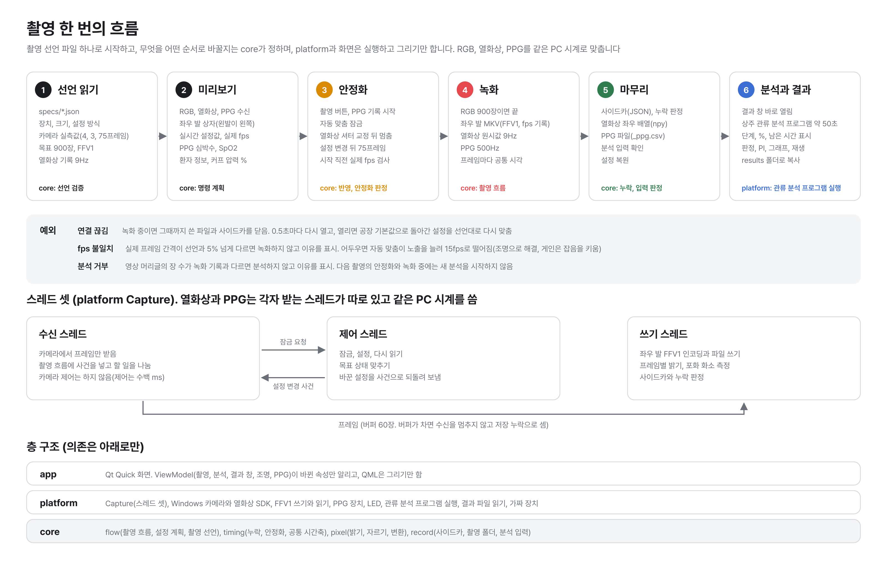

# diabetic-foot-front

**당뇨발 관류 촬영 장비의 촬영 앱 코드(C++20, Qt Quick)입니다. 관류 분석 프로그램은 이 레포 밖의 외부 프로그램이고, 앱은 분석 프로그램 없이도 빌드하고 촬영합니다.** 앱은 RGB 카메라, 열화상 카메라, PPG 센서로 발바닥을 30초 동안 함께 녹화하고, 저장한 촬영을 분석 프로그램에 넘겨 결과를 보여 줍니다.



촬영 한 번(약 33초)을 줄여서 보여 줍니다. 그림의 분석 시간은 그림을 그린 때의 값입니다.



여섯 단계와 각 단계의 판정, 예외, 스레드, 층 구조입니다.

- **코드 길잡이(`hwlab` 이름, 기능별 파일 위치, 이 레포에 없는 것)**<br>[`docs/overview.md`](docs/overview.md)
- **설계**<br>[`docs/00-architecture.md`](docs/00-architecture.md)
- **분석 프로그램과 주고받는 형식**<br>[`docs/analysis-contract.md`](docs/analysis-contract.md)
- **촬영 폴더의 파일과 크기**<br>[`docs/shot-folder.md`](docs/shot-folder.md)
- **로그, 기록 위치, 장비 없는 재현, 인자 전체**<br>[`docs/debugging.md`](docs/debugging.md)
- **도구와 가짜 분석 프로그램**<br>[`tools/README.md`](tools/README.md), [`tools/fake_analysis/README.md`](tools/fake_analysis/README.md)

## 구성

| 폴더 | 내용 |
| --- | --- |
| `core/` | 계산(OS, 장비 무관) |
| `platform/` | 장치, 파일, 관류 분석 프로그램 실행 |
| `app/` | 화면 |
| `specs/` | 촬영 선언 |
| `vendor/` | 제조사 SDK, 샘플, 문서 |
| `docs/` | 코드 길잡이, 설계, 분석 연동 약속, 촬영 폴더, 디버깅 |
| `tools/` | 그림 원본, 결과 창 확인 도구, 가짜 분석 프로그램 |

## 주요 기능

| 기능 | 요점 |
| --- | --- |
| 동시 녹화 | RGB 900장, 열화상 9Hz, PPG 500Hz |
| 좌우 발 분할 | 발마다 따로 저장 |
| 좌우반전 표시 | 화면에서 왼발이 왼쪽 |
| 안정화 | 잠금 뒤 75프레임, fps 검사 |
| 열화상 셔터 교정 | 녹화 직전 한 번 |
| 환자 정보 | 최근 환자, 상완과 발목 혈압, 발목 혈압 단계(촬영 폴더의 가운데 단계) |
| 결과 창 | 분석이 끝나면 요약 값, RGB와 열화상, 관류 지도, 30초 그래프 |

저장 위치는 `문서\DiabeticFoot`입니다. 판정은 참고값이며 진단이 아닙니다.

## 관류 분석 프로그램

**앱은 분석 프로그램 폴더를 빌드할 때 `HWLAB_ANALYZER_DIR`로 받고, 비워 두면 분석 없이 빌드합니다.** 분석 프로그램이 없으면 앱은 분석 칸에 "관류 분석 프로그램 없음"을 보이고, 촬영과 저장은 그대로 합니다.

- **`HWLAB_ANALYZER_DIR`**<br>`dfr_worker.py`가 있는 폴더입니다. `cmake --install`이 `bin/analysis`로 설치합니다. 값을 줬는데 `dfr_worker.py`가 없으면 구성이 멈춥니다
- **`HWLAB_PYTHON_DIR`**<br>분석 프로그램이 쓰는 파이썬 폴더입니다. `bin/python`으로 설치합니다
- **주고받는 방식**<br>앱이 분석 프로그램을 띄우고, 표준 입력의 JSON 한 줄과 표준 출력의 줄, 결과 파일로만 주고받습니다. 형식은 [`docs/analysis-contract.md`](docs/analysis-contract.md)에 있습니다
- **개발할 때**<br>설치하지 않은 분석 프로그램은 앱 인자 `--analyzer-python <python 실행 파일> --analyzer-script <dfr_worker.py>`로 가리킵니다
- **분석 프로그램 없이 개발할 때**<br>`tools/fake_analysis`의 가짜 분석 프로그램이 같은 인자로 뜨고, 모든 촬영에 같은 고정 결과를 냅니다. 실행 방법은 아래 [실행](#실행)에 있습니다

## 준비물

<mark>**Windows는 Visual Studio 2022, Qt, FFmpeg LGPL 공유 빌드, 파이썬을 설치하고 Qt와 FFmpeg 폴더를 환경 변수 두 개로 알려 주면 빌드, 시험, 실행이 됩니다.**</mark> 판은 Windows 시험 노트북에서 확인한 판입니다.

| 준비물 | 확인한 판 | 받는 곳 |
| --- | --- | --- |
| Visual Studio 2022 | 17.14 | [Visual Studio 다운로드](https://visualstudio.microsoft.com/downloads/) |
| Qt, MSVC 2022 64-bit | 6.8.1 | [Qt 온라인 설치 프로그램](https://www.qt.io/download-qt-installer-oss) |
| FFmpeg, win64 LGPL 공유 빌드 | avcodec 63 | [BtbN/FFmpeg-Builds](https://github.com/BtbN/FFmpeg-Builds/releases) |
| 파이썬 | 3.14.7 | [python.org](https://www.python.org/downloads/windows/) |
| Git for Windows | 2.55 | [git-scm.com](https://git-scm.com/downloads/win) |

- **Visual Studio 2022**<br>Community나 Build Tools를 설치할 때 "C++를 사용한 데스크톱 개발" 워크로드를 고릅니다. 이 워크로드에 기본으로 든 "Windows용 C++ CMake 도구"가 CMake(17.14는 3.31.6)와 Ninja를 넣으므로 따로 설치하지 않습니다
- **Qt**<br>Qt 계정이 필요합니다. 설치 프로그램에서 Qt 6.8.1 아래의 "MSVC 2022 64-bit"를 고릅니다. Debug 빌드가 쓰는 Qt 디버그 DLL(`Qt6Cored.dll` 등)도 이 항목에 들어 있습니다. CMake는 Qt 6.5 이상을 받지만 6.8.1에서만 확인했습니다
- **FFmpeg**<br>`ffmpeg-master-latest-win64-lgpl-shared.zip`을 받아 풀고, `include`, `lib`, `bin`이 바로 아래에 있는 폴더를 씁니다. 파일 이름에 `lgpl-shared`가 있어야 합니다. GPL 빌드는 배포할 수 없고, shared가 아닌 빌드에는 DLL이 없습니다. 확인한 것은 2026-10-20 자동 빌드(N-127790)이고, BtbN이 지난 자동 빌드를 지워 이 파일은 더 받을 수 없습니다
- **파이썬**<br>가짜 분석 프로그램과 platform 시험 하나가 3.9 이상을 씁니다. python.org 설치 프로그램에서 "Add python.exe to PATH"를 고릅니다. Microsoft Store가 PATH에 넣는 `python` 별칭(`WindowsApps\python.exe`)은 앱이 실행 파일로 읽지 못해 "파이썬 없음"이 됩니다
- **네트워크**<br>처음 구성할 때 github.com에서 googletest 1.15.2를 받습니다. 받지 못하는 PC는 [네트워크 없이 구성](#네트워크-없이-구성)을 봅니다
- **macOS**<br>Xcode 명령줄 도구(`xcode-select --install`)와 Homebrew의 `cmake`, `ninja`, `qt`, `ffmpeg`, `python`을 씁니다. Homebrew의 FFmpeg는 GPL 빌드라 시험에만 씁니다

## Visual Studio에서 열고 F5로 실행

<mark>**레포 폴더를 Visual Studio로 열면 `CMakePresets.json`의 Windows Debug로 구성합니다. 빌드가 Qt, FFmpeg, 제조사 SDK DLL을 실행 파일 옆에 모으므로 F5로 바로 뜹니다.**</mark>

1. Qt와 FFmpeg 폴더를 사용자 환경 변수로 한 번 정합니다. PowerShell에서 실행하고, 열려 있던 Visual Studio는 닫았다가 다시 엽니다.

   ```powershell
   [Environment]::SetEnvironmentVariable('HWLAB_QT_DIR', 'C:\Qt\6.8.1\msvc2022_64', 'User')
   [Environment]::SetEnvironmentVariable('HWLAB_FFMPEG_DIR', 'C:\ffmpeg\ffmpeg-master-latest-win64-lgpl-shared', 'User')
   ```

2. **파일 > 열기 > 폴더**로 레포 폴더를 엽니다. 구성 프리셋 **Windows Debug**로 구성하고, 처음 구성은 googletest를 받습니다.
3. **빌드 > 모두 빌드**를 누릅니다. 빌드 폴더는 `build\windows-debug`입니다.
4. 시작 항목에서 **앱: 가짜 장치와 가짜 분석**을 고르고 F5를 누릅니다. 환자 정보가 채워진 채로 뜨므로, 촬영을 누르면 30초 녹화 뒤 결과 창이 열립니다.

| 시작 항목 | 띄우는 것 |
| --- | --- |
| 앱: 가짜 장치 | 장비 없는 촬영 화면 |
| 앱: 가짜 장치와 가짜 분석 | 촬영부터 결과 창까지 |
| 앱: 결과 창(촬영 폴더를 고쳐 씀) | 분석이 끝난 촬영의 결과 창 |

시작 항목은 `.vs\launch.vs.json`에 있습니다. 촬영은 `build\shots`에 저장하고, 가짜 촬영 한 번이 약 490 MB입니다([촬영 폴더](docs/shot-folder.md)). 빌드 폴더에서 띄운 앱은 `dev` 프로필을 써서 설치본과 설정, 기록, 로그 위치를 나눕니다. 로그 파일과 출력 창에서 보는 법은 [디버깅과 관찰](docs/debugging.md)에 있습니다.

- **결과 창 항목**<br>**디버그 > 디버그 및 시작 설정**으로 `launch.vs.json`을 열고, `<날짜_시각 폴더>`를 `build\shots\테스트_19551103\0\` 아래의 실제 폴더 이름으로 바꿉니다
- **환경 변수 대신 파일로**<br>`CMakeUserPresets.json.example`을 `CMakeUserPresets.json`으로 복사해 두 경로를 고치고, 구성 프리셋 **Windows Debug (내 PC 경로)**를 고릅니다. 이 파일은 레포에 넣지 않습니다
- **구성이 멈추면**<br>FFmpeg나 Qt 폴더가 없거나 틀리면 구성이 멈추고, 출력 창의 CMake 오류가 줄 값을 알려 줍니다
- **Visual Studio Code**<br>CMake Tools와 C/C++ 확장을 설치하고 레포 폴더를 엽니다. `.vscode/settings.json`이 프리셋을 쓰게 하고, `.vscode/launch.json`에 같은 실행 항목이 있습니다. 실행 대상(launch target)은 `hwlab_app`을 고릅니다

## 명령줄에서 빌드하고 실행

Windows는 시작 메뉴의 **Developer PowerShell for VS 2022**를 열고 레포 폴더에서 실행합니다. 이 창이 MSVC, CMake, Ninja를 PATH에 둡니다. Visual Studio 안의 터미널(**보기 > 터미널**)도 같습니다.

```powershell
cmake --preset windows-debug
cmake --build --preset windows-debug
ctest --preset windows-debug
.\build\windows-debug\app\hwlab_app.exe --spec specs\see3cam_manual_720p60.json --out build\shots --fake --analyzer-python python --analyzer-script tools\fake_analysis\dfr_worker.py
```

macOS는 터미널에서 실행합니다.

```bash
cmake --preset macos-debug
cmake --build --preset macos-debug
ctest --preset macos-debug
build/macos-debug/app/hwlab_app --spec specs/see3cam_manual_720p60.json --out build/shots --fake \
  --analyzer-python python3 --analyzer-script tools/fake_analysis/dfr_worker.py
```

- **Release**<br>프리셋 이름의 `debug`를 `release`로 바꿉니다. 빌드 폴더는 `build\windows-release`입니다
- **상대 경로**<br>`--spec`, `--out`, `--analyzer-script`의 상대 경로는 앱을 띄운 폴더 기준입니다. `python`처럼 이름만 준 파이썬은 PATH에서 찾습니다
- **파이썬을 찾지 못하면**<br>분석 칸에 "파이썬 없음: python (PATH에서 찾지 못했습니다)"가 보입니다. PowerShell에서 `where.exe python`으로 위치를 확인해 전체 경로를 줍니다
- **배포 폴더**<br>`cmake --install build\windows-release --prefix <배포 폴더(절대 경로)>`가 Qt 경로 없이 실행되는 폴더를 만듭니다
- **층 하나만 구성**<br>`cmake -S core`, `-S platform`, `-S app`도 됩니다. 그때는 아래층의 시험을 빌드하지 않습니다

## 시험

<mark>**`ctest --preset <프리셋>`이 core, platform, app의 시험 570개를 4개씩 함께 돌리고, 시험을 하나도 찾지 못하면 실패합니다.**</mark> Windows 시험 노트북에서 core 265개, platform 298개, app 7개가 모두 통과했습니다(Debug, 65초).

- **하나만 돌리기**<br>`ctest --preset windows-debug -R Settle`처럼 시험 이름의 일부를 줍니다. gtest 실행 파일에는 `--gtest_filter`를 줍니다

  ```powershell
  .\build\windows-debug\core\test\test_timing.exe --gtest_filter=Settle.*
  ```

- **app 시험의 함수 하나**<br>app 시험은 실행 파일 하나가 ctest 시험 하나입니다. 실행 파일에 함수 이름을 주면 그 함수만 돕니다

  ```powershell
  $env:PATH = "$env:HWLAB_QT_DIR\bin;$env:PATH"; $env:QT_QPA_PLATFORM = 'offscreen'
  .\build\windows-debug\app\test_capture_controller.exe ClosesRightAwayWhenIdle
  ```

- **함께 돌리는 수**<br>`ctest --preset windows-debug -j 8`처럼 바꿉니다. `-j 1`이면 하나씩 돌립니다
- **app 시험 끄기**<br>`-DHWLAB_APP_TESTS=OFF`를 줍니다. core와 platform은 `HWLAB_BUILD_TESTS`, `HWLAB_PLATFORM_TESTS`입니다

### 네트워크 없이 구성

github.com에 닿지 않는 PC는 googletest를 받는 데서 구성이 멈춥니다. 다른 PC에서 [googletest 1.15.2 소스 zip](https://github.com/google/googletest/archive/refs/tags/v1.15.2.zip)을 받아 풀고, 처음 구성할 때 그 폴더를 줍니다.

```powershell
cmake --preset windows-debug -DFETCHCONTENT_SOURCE_DIR_GOOGLETEST=C:/src/googletest-1.15.2
```

시험 없이 빌드하려면 `-DHWLAB_BUILD_TESTS=OFF -DHWLAB_PLATFORM_TESTS=OFF -DHWLAB_APP_TESTS=OFF`를 줍니다. 그때 `ctest --preset`은 시험이 없어 실패합니다.

## 실행

```powershell
.\build\windows-debug\app\hwlab_app.exe --spec specs\see3cam_manual_720p60.json --out <저장 폴더>
```

- **`--out`**<br>처음 저장 위치입니다. 화면에서 고른 저장 위치를 기억하고 있으면 그 위치를 씁니다
- **`--fake`**<br>장비 없이 가짜 RGB 카메라, 가짜 열화상 카메라, 가짜 PPG 장치로 실행합니다. 분석 프로그램이 없어도 뜹니다. 화면에서 바꾼 값을 다음 실행에 남기지 않습니다
- **`--result <촬영 폴더>`**<br>그 촬영의 결과 창만 엽니다
- **`--no-prestream`**<br>녹화 중 미리 분석을 쓰지 않습니다

인자 전체는 `hwlab_app.exe --help`나 [디버깅과 관찰의 인자 전체](docs/debugging.md#인자-전체)에 있습니다.

### 분석 프로그램 없이 결과 창까지 보기

**`--fake`에 `tools/fake_analysis`의 가짜 분석 프로그램을 더하면 장비도 실제 분석 프로그램도 없이 촬영, 분석 상태 막대, 결과 창을 끝까지 볼 수 있습니다.** 파이썬 3.9 이상만 있으면 되고, 가짜 분석 프로그램은 모든 촬영에 같은 고정 결과를 냅니다. Visual Studio의 시작 항목 **앱: 가짜 장치와 가짜 분석**과 위 명령줄 실행이 이 방법입니다.

- **설치 폴더에 넣기**<br>구성할 때 `-DHWLAB_ANALYZER_DIR=<레포 전체 경로>/tools/fake_analysis`를 주면 `cmake --install`이 `bin/analysis`로 설치합니다. 앱은 `bin/python`의 파이썬을 쓰므로 Windows는 `HWLAB_PYTHON_DIR`도 줍니다
- **인자, 고정 결과 값, 실패 흉내**<br>[`tools/fake_analysis/README.md`](tools/fake_analysis/README.md)
