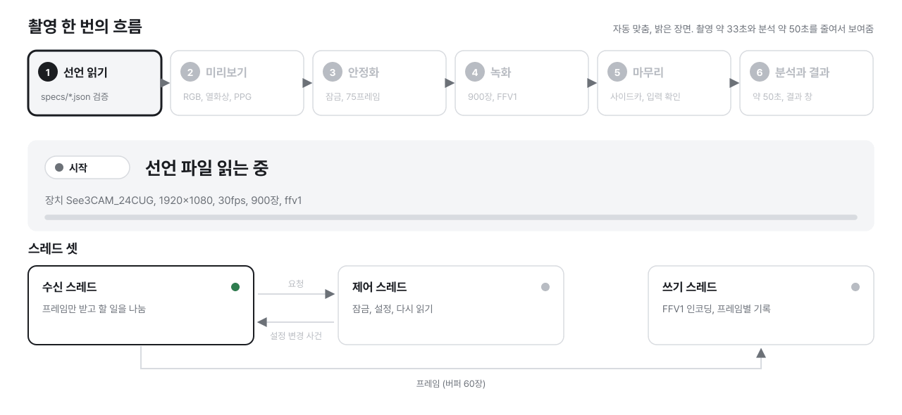
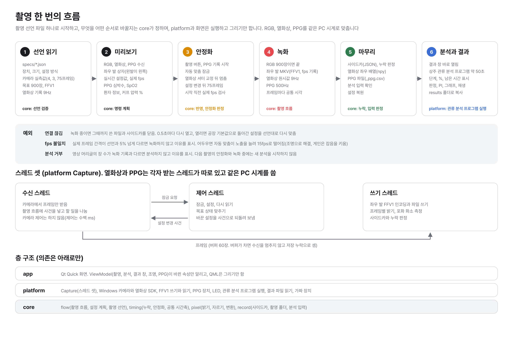

# 촬영 장비 아키텍처

diabetic-foot-front 아키텍처 설계도, 2026-10-16 작성

이 문서를 처음 여는 사람은 먼저 [overview.md](overview.md)를 봅니다. 코드 이름 `hwlab`의 뜻, 기능별 파일 위치, 이 레포에 없는 것(분석 프로그램, 설치 프로그램, 이전 레포 이슈 번호, 기존 앱, 실험 노트북)이 거기 있습니다. 촬영이 디스크에 남기는 파일은 [shot-folder.md](shot-folder.md)에 있습니다.

대상 제품은 당뇨발 관류 촬영 장비입니다. 어두운 방에서 LED 조명을 켜고, RGB 카메라(See3CAM_24CUG)와 열화상 카메라(TE-EV1)로 발바닥을 동시에 녹화합니다. 녹화 길이는 시간이 아니라 RGB 프레임 수(30fps에서 900장)로 정합니다. 녹화한 영상은 관류 분석에 쓰입니다.

주된 분리 기준은 하나입니다. **검증 비용이 크고 천천히 바뀌는 것**(프레임 시각 판정, 설정값 반영 판정, 화소 연산, 저장 파일 형식)과 **장비와 OS에 따라 바뀌는 것**(Windows 카메라 API, 제조사 SDK, 화면)을 나눕니다. 앞의 것은 core, 뒤의 것은 platform과 app에 둡니다.

설계는 세 문장으로 요약됩니다.

- **core는 장비를 조작하지 않습니다.** 프레임과 사건(설정값을 바꾼 시점, 연결 끊김)을 받아 판정하고 변환합니다
- **core는 장비별 숫자를 고정하지 않습니다.** 설정값이 몇 번째 프레임부터 반영되는지 같은 값은 platform이 장비 정보로 넘깁니다
- **core는 처음부터 여러 스트림을 전제로 합니다.** 모든 프레임에 스트림 종류와 시각이 붙어 있어 RGB와 열화상을 시각으로 맞출 수 있습니다

## 목차

1. [그림 1 촬영 한 번의 흐름](#그림-1-촬영-한-번의-흐름)
2. [도해 1 층 구조](#도해-1-층-구조)
3. [표 1 core 공개 API](#표-1-core-공개-api)
   - [platform 공개 헤더](#platform-공개-헤더)
4. [표 2 도메인 용어](#표-2-도메인-용어)
5. [표 3 네이밍 규약](#표-3-네이밍-규약)
6. [표 4 촬영 상태](#표-4-촬영-상태)
7. [표 5 장비 명세와 실측값](#표-5-장비-명세와-실측값)
8. [표 6 모듈과 빌드](#표-6-모듈과-빌드)
9. [표 7 검증](#표-7-검증)
10. [표 8 이 구조의 대가](#표-8-이-구조의-대가)
11. [표 9 마일스톤](#표-9-마일스톤)
12. [표 10 미해결](#표-10-미해결)
13. [표 11 기존 앱과 달라진 동작](#표-11-기존-앱과-달라진-동작)
14. [표 12 기존 앱 기능의 층 배치](#표-12-기존-앱-기능의-층-배치)
15. [개정 기록](#개정-기록)

## 그림 1 촬영 한 번의 흐름





그림은 네 부분입니다. **위쪽 다섯 칸은 촬영 한 번의 순서이고, 칸 아래 색 글자는 그 단계의 판정을 맡는 core 기능입니다.** 원본은 `tools/draw_flow.py`(정지 그림)와 `tools/draw_flow_animation.py`(애니메이션)이고, 코드가 바뀌면 이 스크립트를 고쳐 다시 그립니다. 애니메이션은 자동 맞춤으로 밝은 장면을 찍는 한 번을 시간 순서로 보여주며, 실제 약 33초를 줄였습니다.

| 부분 | 내용 | 자세한 곳 |
| --- | --- | --- |
| 단계 1 선언 읽기 | 촬영 선언 파일을 읽고 검증 | 표 2 촬영 선언, `flow/capture_spec.h` |
| 단계 2 미리보기 | 목표 상태로 맞추고 다시 읽음 | 표 2 목표 상태 맞추기, `flow/settings_plan.h` |
| 단계 3 안정화 | 잠금 완료와 75프레임을 기다리고 실제 fps 검사. PPG를 연 촬영은 PPG 안정 대기도 기다리고, 열화상을 쓰면 잠금과 열화상 준비를 대기가 셔터 교정 시간만큼 남을 때 함 | 표 4, 표 5, `timing/settle.h` |
| 단계 4 녹화 | 900장을 FFV1로 쓰고 프레임별 기록 | 표 4, 표 11, `record/sidecar.h` |
| 단계 5 마무리 | 사이드카, 누락 판정, 미리보기 목표로 되돌림 | `timing/frame_gap.h` |
| 예외 | 연결 끊김, fps 불일치 | 표 4, 표 10 |
| 스레드 셋 | 수신, 제어, 쓰기 | platform `Capture` |
| 층 구조 | app, platform, core | 도해 1 |

- **색은 단계의 상태를 나타냅니다.** 주황은 안정화, 빨강은 녹화, 초록은 마무리입니다. 앱 화면의 상태 표시와 같은 색입니다
- **화살표는 데이터가 가는 방향입니다.** 스레드 사이에서 수신 스레드는 잠금 요청을 제어 스레드로 보내고, 제어 스레드는 바꾼 설정을 사건으로 돌려보냅니다. 프레임은 제어 스레드를 거치지 않고 버퍼를 통해 쓰기 스레드로 갑니다
- **스레드를 셋으로 나눈 이유는 실측입니다.** 확장 유닛 설정 읽기가 345ms 동안 프레임 수신을 막은 적이 있어(2026-10-16), 카메라 제어를 수신 스레드에서 하지 않습니다

## 도해 1 층 구조

**설정과 실행 순서는 선언으로 정합니다.** 화면과 platform은 촬영 선언과 목표 상태를 넘기고, 무엇을 어떤 순서로 바꿀지는 core의 순수 함수가 정합니다. 미리보기 설정, 잠금, 실험 뒤 복원, 재연결 뒤 재설정이 모두 목표 상태 하나를 넘기는 같은 동작입니다.

규칙은 셋입니다. **의존은 아래로만 향합니다.** **벤더 타입은 감싸는 구현 파일 밖으로 나오지 않습니다.** **core에는 OS에 의존하는 코드가 없습니다.** core에는 스레드, 시계, 파일 입출력이 없고, 같은 입력에는 항상 같은 출력을 냅니다. 층마다 빌드 타깃을 따로 두고 include 경로를 제한해서, 위 층을 include하면 빌드가 실패합니다.

```text
app        화면(Qt Quick), 촬영 흐름
  │
platform   Windows 카메라(Media Foundation, DirectShow, e-con SDK), 열화상(i3 SDK), LED, PPG
  │
core       hwlab::flow     촬영 흐름 판정(미리보기, 안정화, 녹화, 연결 끊김)
           hwlab::record   저장 형식(AVI, 사이드카, 매니페스트)을 바이트로 만듦, 촬영 폴더 이름
           hwlab::timing   프레임 시각 판정, 설정값 반영 판정, 공통 시간축
           hwlab::pixel    화소 연산(영역 평균, 자르기, 좌우 분할, 깜빡임 요약, 열화상 변환)
           hwlab::         공용 어휘(프레임, 시각, 스트림, 설정값)
```

app은 MVVM 구조입니다. Model은 core와 platform(`Capture`), ViewModel은 `CaptureController`(바뀐 속성만 알림), View는 QML입니다. 상태는 ViewModel에서 QML로만 내려가고 사용자 동작은 신호와 함수로만 올라갑니다. QML 부품(`Stepper`, `Segmented`, `ReadbackRow`, `RecordButton`)은 자기 상태가 없고 입력을 `required property`로 받습니다. 편집 중인 값은 화면 최상위로 끌어올려 두고, '적용' 전에는 카메라에 보내지 않습니다.

촬영 화면(`Main.qml`)은 입력, 미리보기(RGB와 열화상을 같은 높이로 나란히, PPG를 연결하면 그 아래 맥파), 장치 상태 한 줄, 경고와 촬영 버튼을 위에서 아래로 둡니다. 개발과 시험 기록에 쓰는 값(카메라 설정과 다시 읽은 값, 발 상자 RGB, 조명과 PPG 포트, 저장 위치, 렌즈 보정, 분석 판, 녹화 중 미리 분석)은 "설정"을 누르면 오른쪽에서 열리는 설정 패널(`SettingsPanel.qml`)에 있습니다. 설정 패널은 화면을 막지 않아 열린 채로 RGB 미리보기를 눌러 관찰 영역을 정하고, 열린 동안만 영상 위에 장치 이름과 실제 fps, 발 상자 크기, 열화상 원시값 범위를 그립니다. 설정 패널로 옮긴 값의 경고(발 상자 포화, 다시 읽은 값 불일치, LED 반영 안 됨, PPG 오류, 저장 공간)는 촬영 화면의 경고 줄에 남깁니다.

설정 패널의 RGB 패널(`RgbPanel`)의 ViewModel은 `RgbTrace`입니다. 수신 스레드가 미리보기 10장/초마다 두 발 상자와 관찰 영역의 채널별 평균과 채널 포화 비율을 재(`pixel::MeasureRgb`) 화면 스레드로 보내고, 화면 스레드가 대상마다 최근 5분을 둡니다. 발 상자나 관찰 영역을 옮기면 그 대상의 기록을 지우고, 옮기기 전 위치로 잰 채 오던 표본도 버립니다. 표본이 1초 넘게 오지 않으면 `stale`이 켜지고, 패널은 숫자를 흐리게 그리며 '실시간' 자리에 '멈춤'을 씁니다. 값은 화면 표시용이고 녹화와 사이드카에 남기지 않습니다.

관류 분석 프로그램은 이 세 층 밖의 외부 프로그램(파이썬)이며 이 레포에 없습니다. platform이 `ChildProcess`로 실행하고 요청 줄과 출력 줄로만 주고받으며, C++ 코드는 이 프로그램의 파일을 include하거나 읽지 않습니다. 앱은 분석 프로그램 폴더와 진입 스크립트 이름을 빌드 때 `HWLAB_ANALYZER_DIR`, `HWLAB_ANALYZER_ENTRY`로 받아 설치하고, 값이 비어 있으면 분석 없이 빌드합니다. 앱과 관류 분석 프로그램이 주고받는 방식(요청과 출력, 녹화 중 미리 분석, 분석 판, 결과 파일)은 [분석 API 저장소](https://github.com/deep-medi-Research/diabetic-foot-api)가 정하고, 앱은 레포 루트의 `ANALYSIS_API_VERSION` 판을 따릅니다. 앱 쪽 구현은 [analysis-contract.md](analysis-contract.md)에 있습니다.

층 판정 기준입니다. 사건을 받아 촬영 상태와 할 일을 정하면 `flow`, 화소 배열을 다루면 `pixel`, 프레임의 시각이나 순서로 판정하면 `timing`, 저장 파일의 바이트를 만들면 `record`, 어느 층에도 속하지 않는 값 타입이면 루트(`hwlab::`)입니다.

## 표 1 core 공개 API

app과 platform은 C++로 작성하므로 C ABI를 두지 않습니다. 공용 어휘 헤더는 `core/include/hwlab/`, 층별 헤더는 `core/src/<층>/include/hwlab/<층>/`에 있고, 모두 `hwlab/`로 시작하는 경로로 include합니다.

| 헤더 | 내용 |
| --- | --- |
| `hwlab/timestamp.h` | 시각(마이크로초) |
| `hwlab/stream.h` | 스트림 종류, 프레임 번호 |
| `hwlab/frame.h` | 화소 형식, 프레임 뷰 |
| `hwlab/camera_settings.h` | 노출 단계, 게인, 색온도, fps |
| `hwlab/timing/frame_gap.h` | 프레임 누락 판정 |
| `hwlab/timing/settle.h` | 설정값 반영과 안정화 판정 |
| `hwlab/timing/clock_map.h` | 장치 시각을 공통 시간축으로 옮기는 식, 수신 빈틈으로 나눈 시계 구간, 스트림 사이 가장 가까운 프레임 |
| `hwlab/timing/record_rate.h` | 받은 프레임 중 파일에 쓸 프레임을 기록 주기로 고름(`AdvanceRecordRate`) |
| `hwlab/timing/window_index.h` | 녹화 시각에 보여 줄 분석 창 번호(`WindowIndexAt`) |
| `hwlab/timing/warmup.h` | 열화상 카메라 온도로 예열 단계 판정(`AfterCameraTemperature`), 적용된 렌즈 셰이딩 보정을 지금 온도와 견주는 판정(`JudgeLensShadingFit`) |
| `hwlab/pixel/rect.h` | 영역, 색차 격자 맞춤 |
| `hwlab/pixel/brightness.h` | 영역 밝기(전 화소 합계, 포화 화소 수), 프레임별 합계의 깜빡임 요약 |
| `hwlab/pixel/crop.h` | 영역 자르기, 좌우 분할 |
| `hwlab/pixel/side_regions.h` | 좌우 영역의 기본값, 프레임 안으로 옮기기, 녹화 전 검사(`CheckSideRegions`) |
| `hwlab/pixel/calibration_watch.h` | 프레임 서명, 프레임 내용으로 셔터 교정 구간 판정(`AfterCalibrationFrame`) |
| `hwlab/record/avi.h` | 무압축 AVI(OpenDML) 바이트와 고칠 위치 |
| `hwlab/record/sidecar.h` | 사이드카 JSON(영상, PPG), PPG 측정 오류 구간 찾기와 RGB 녹화 구간 안 집계 |
| `hwlab/flow/flow.h` | 촬영 상태와 사건을 받아 다음 상태와 platform이 할 일을 돌려줌 |
| `hwlab/flow/settings_plan.h` | 설정 선언에서 목표 상태를 만들고, 현재 상태와의 차이를 명령 목록으로 만듦 |
| `hwlab/flow/capture_spec.h` | 촬영 선언, 검증, JSON 선언 파일 읽기, 코덱별 확장자 |
| `hwlab/record/shot.h` | 촬영 폴더와 파일 이름(코덱별 확장자, 번호를 넣은 폴더 이름), 장치 목록이 들어 있는 매니페스트 |
| `hwlab/record/shot_limits.h` | 저장 한계 검사(촬영 한 번이 쓸 바이트 상한, 디스크 여유 판정, 가장 긴 파일 경로 길이) |
| `hwlab/record/analysis_inputs.h` | 사이드카 요약 읽기, 열화상 발 영역, 분석 전 확인(`CheckAnalysisInputs`) |
| `hwlab/pixel/convert.h` | 열화상 원시값 범위와 8비트 변환, 미리보기 RGB 변환 |
| `hwlab/pixel/rgb_sums.h` | 영역의 채널별 RGB 합계와 채널 포화 화소 수(미리보기 RGB 변환과 같은 계산) |

### platform 공개 헤더

platform 헤더는 `platform/include/hwlab/platform/`에 있고 네임스페이스는 `hwlab::platform`입니다. OS와 장치에 의존하는 동작을 맡지만, 벤더 타입은 헤더에 나오지 않고 OS별 구현 파일(`platform/src/windows/`)에만 있습니다.

| 헤더 | 내용 |
| --- | --- |
| `hwlab/platform/capture.h` | 촬영 선언 하나를 스레드 셋(수신, 제어, 쓰기)으로 실행 |
| `hwlab/platform/rgb_camera.h` | RGB 카메라, 목표 상태 맞추기(`Reconcile`) |
| `hwlab/platform/fake_camera.h` | 장비 없이 시험하는 RGB 카메라 |
| `hwlab/platform/frame_pool.h` | 수신 스레드와 쓰기 스레드 사이의 버퍼와 대기열 |
| `hwlab/platform/video_writer.h` | 영상 파일 쓰기, 코덱별 생성(`MakeVideoWriter`) |
| `hwlab/platform/avi_file.h` | 무압축 AVI 파일 쓰기 |
| `hwlab/platform/thermal_camera.h` | 열화상 카메라, 연결 끊김 판정(`JudgeThermalConnection`), 카메라 온도(`CameraTemperature`), TE-EV1 예열 판정 수치(`kTeEv1WarmupRule`), 보정 때의 카메라 온도 기록 파일 |
| `hwlab/platform/fake_thermal_camera.h` | 장비 없이 시험하는 열화상 카메라 |
| `hwlab/platform/thermal_writer.h` | 원시값 파일, 확인용 영상, 영역 자르기, `.npy` 쓰기 |
| `hwlab/platform/serial_port.h` | 직렬 포트 목록과 열기, 기다리는 읽기 깨우기(`WakeRead`) |
| `hwlab/platform/fake_serial_port.h` | 장비 없이 시험하는 직렬 포트. 쓰기 알림(`WaitForWrites`), 돌아오지 않는 쓰기 흉내(`HoldWrites`) |
| `hwlab/platform/light.h` | LED 밝기 명령과 조명 제어(`Light`) |
| `hwlab/platform/ppg_wire.h` | PPG 장치 메시지 만들기와 나누기(`PpgParser`), 측정 데이터 풀기 |
| `hwlab/platform/ppg_sensor.h` | PPG 장치 스레드(`PpgSensor`)와 그 스레드가 쓰는 연결(`PpgLink`), 연결 상태(`PpgState`, `PpgSnapshot`), PPG 촬영 기록(`PpgShotRecord`), 화면 파형 점(`PpgWavePoints`), 다시 시작 판단(`PpgNeedsRestart`), PPG 안정 대기 시간(`kPpgSettleUs`), PPG 파일과 PPG 사이드카 쓰기, 측정 오류 집계 문장 |
| `hwlab/platform/fake_ppg_device.h` | 장비 없이 시험하는 PPG 장치 |
| `hwlab/platform/shot_folder.h` | UTF-8 경로, 촬영 폴더 만들기, 매니페스트 쓰기 |
| `hwlab/platform/child_process.h` | 외부 프로세스 실행, 출력 줄 읽기, 하위 프로세스까지 종료(`ChildProcess`) |
| `hwlab/platform/perfusion_analysis.h` | 관류 분석 프로그램 요청 줄 만들기, 출력 줄 해석 |
| `hwlab/platform/keep_awake.h` | 앱이 떠 있는 동안 시스템 잠자기 막기(`KeepAwake`). Windows만 OS를 부르고 다른 OS는 아무것도 하지 않음 |

## 표 2 도메인 용어

| 용어 | 뜻 | 쓰지 않는 말 |
| --- | --- | --- |
| 스트림 | 장비 하나가 내는 프레임의 연속. RGB, 열화상 | 채널, 피드 |
| 프레임 | 스트림의 영상 한 장과 그 시각 | 이미지, 샘플 |
| 프레임 시각 | 장비 또는 드라이버가 프레임에 붙인 시각 | 타임스탬프와 혼용 |
| 수신 지연 | 촬영에서 PC가 프레임을 받기까지의 시간 | |
| 공통 시간축 | 스트림마다 다른 장치 시각을 옮겨 비교하는 기준 시계. PC 시계 | |
| 공통 시각 | 공통 시간축으로 옮긴 프레임 시각. 수신 지연이 가장 짧은 경우의 PC 수신 시각 | |
| 시계 맞춤식 | 장치 시각에서 공통 시각을 구하는 선형식(오프셋, 속도 비). 사이드카에 남김 | |
| 수신 빈틈 | 장치 시각은 이어지는데 이웃한 두 시계 맞춤 표본의 PC 수신 시각이 장치 시각보다 정한 시간 넘게 더 벌어진 자리. 장치가 그동안 표본을 보내지 않음 | 끊김. 누락(장치 시각 간격으로 판정)과 구분 |
| 시계 구간 | 수신 빈틈으로 나눈 시계 맞춤 표본의 묶음. 속도 비는 모든 구간이 같고 오프셋은 구간마다 따로 맞춤(`ClockSegment`) | 세그먼트 |
| 프레임 간격 | 이웃한 두 프레임 시각의 차이 | |
| 누락 | 프레임 간격이 정해진 주기의 1.5배를 넘는 자리 | 드롭(앱 큐 넘침과 구분) |
| 저장 누락 | 앱이 파일에 쓰지 못하고 버린 프레임. 쓰기 버퍼가 없어 버린 프레임과 파일 쓰기에 실패한 프레임. 버퍼가 없어 버린 만큼 더 받아 목표 프레임 수를 채웁니다 | |
| 느린 간격 | 이웃한 두 프레임의 간격이 주기의 1.2배를 넘고 1.5배 이하인 자리. 30fps에서 25fps(40ms)로 떨어지면 생기며, 1.5배를 넘는 카메라 단 누락과 따로 셈(`timing::CheckFrameRate`). 다음 느린 간격이 1초 안에 오면 같은 구간으로 묶음 | |
| fps 저하 | 녹화 중 느린 간격이 있는 것. 사이드카 `frames.slow_intervals`, `frames.slow_spans`(첫 받은 프레임 기준 `start_us`, `end_us`, 간격 수), `frames.min_fps_1s`(1초 창 최저 fps)에 남기고, 촬영 결과 줄과 결과 창 분석 품질에 "fps 저하 12.3~14.1초, 최저 25.0fps"로 보임(`DescribeSlowFrames`). 분석은 막지 않음 | 프레임 드롭 |
| 목표 프레임 수 | 녹화를 끝내는 RGB 프레임 수. 파일에 쓴 프레임만 셈 | 녹화 시간 |
| 설정값 | 노출 단계, 게인, 색온도, fps | 파라미터 |
| 노출 단계 | DirectShow 노출값. 1 커지면 노출 시간 2배 | 셔터 |
| 설정 변경 | platform이 카메라에 설정값을 설정한 사건 | 쓰기 |
| 자동 맞춤 | 카메라 펌웨어 자동 노출로 맞추다가 촬영 버튼에서 확장 유닛 잠금으로 고정하는 동작. 열화상과 PPG를 함께 쓰는 촬영은 PPG 안정 대기가 셔터 교정 시간만큼 남을 때 잠금 | 앱 자동 노출 |
| 직접 지정 | 사용자가 입력한 설정값을 그대로 설정하는 동작 | 수동 모드 |
| 반영 프레임 | 설정 변경 뒤 새 설정값으로 찍힌 첫 프레임 | |
| 블랙 레벨 | 빛이 없을 때 센서가 내는 기준값 | 오프셋 |
| 영역 | 프레임 안의 사각형. 화소 단위, 좌상단 원점 | ROI, 박스 |
| 색차 격자 | 색차를 공유하는 화소 묶음. UYVY 가로 2, NV12 가로 2 세로 2 | |
| 밝기 | UYVY와 NV12의 Y, 열화상의 원시값 | 휘도와 혼용 |
| 포화 화소 | 밝기가 정한 값 이상인 화소 | 클리핑 |
| 채널 포화 화소 | 미리보기 RGB 변환(BT.601 제한 범위)으로 바꾼 R, G, B 중 그 채널 값이 255인 화소. 화면 RGB 패널의 포화 비율에만 씀(`pixel::MeasureRgb`) | |
| 관찰 영역 | 화면 RGB 패널에서 채널별 평균과 포화 비율을 따로 보려고 미리보기 위에 그린 사각형. 프레임 화소 좌표이고 녹화와 사이드카에 남기지 않음(`RgbTrace`) | ROI |
| 조명 밝기 | LED 보드에 마지막으로 보내는 데 성공한 밝기(%). 장치에서 읽은 값이 아님 | 현재 밝기 |
| 깜빡임 | 프레임마다 영역 평균 밝기가 주기적으로 달라지는 것 | 플리커 |
| 맥놀이 주기 | PWM 주파수와 fps의 차이로 정해지는 깜빡임 주기(프레임 수) | |
| 좌우 분할 | 영역을 가운데 세로선에서 폭이 같은 두 영역으로 나눔. 발 하나씩 저장 | |
| 좌우 영역 | 한 프레임 안에서 발 하나씩 따로 저장하는 두 영역. 화소 왼쪽 영역과 화소 오른쪽 영역이고, 어느 쪽이 환자의 왼발인지는 촬영 정보가 정함. 화면은 발 상자로 그림. 녹화 전에 색차 격자 맞춤, 세로형, 순서, 교차를 검사함(`pixel::SideRegions`) | |
| 안정화 | 설정 변경 뒤 블랙 레벨 변화가 끝날 때까지 기다리는 구간 | 정착, 수렴 |
| 사이드카 | 영상 파일과 PPG 파일마다 하나씩 두는 JSON. 촬영 조건, 다시 읽은 설정값, 누락 기록, 프레임별 기록. 열화상은 렌즈 셰이딩 보정 결과. PPG는 장치 정보, 시계 구간, 누락, 측정 오류 구간과 RGB 녹화 구간 안 집계, 통신 집계, 장치 상태 | 메타데이터 파일 |
| 프레임별 기록 | 파일에 쓴 프레임마다 남기는 수신 번호, 장치 시각, 수신 시각, 공통 시각, 영역 밝기 합계, 포화 화소 수 | |
| 기록 주기 | 열화상에서 받은 프레임 중 파일에 쓸 프레임을 고르는 간격. 촬영 선언의 `thermal_record_period_us`(111111us, 9.0Hz)이고 0이면 모두 씀. 실측 간격 중앙값이 주기의 80%보다 짧을 때만 고름(`timing::RecordRateRule`) | |
| 셔터 교정 | 열화상 장치가 셔터를 닫고 화소 값을 다시 맞추는 동작. 그동안 같은 프레임이 이어지므로 프레임 내용의 서명으로 교정 구간을 판정하고, 교정 뒤 정한 장 수를 버림(`pixel::CalibrationWatch`). 장치별 수치는 platform이 넘김 | |
| 원시값 파일 | 열화상 원시값을 머리글 없이 리틀 엔디언 uint16으로 이어 쓴 파일(`.raw16`). 크기와 프레임 수는 사이드카에 남김 | |
| 카메라 온도 | 열화상 카메라가 받은 프레임마다 알려 주는 카메라 자신의 값 셋. 장면의 온도가 아님. FPA 값(SDK 문서에 단위가 없어 °C로 보지 않음. TE-EV1 2026-10-28 켠 뒤 70분 실측 88.2~98.3, 0.061 간격), 셔터 PT100 원시값(셔터가 닫힐 때만 바뀜), 그 원시값을 식(원시값 × 0.005417 - 87.8602)으로 옮긴 셔터 온도(°C, 원시값 22981에서 SDK 함수와 같은 36.628). 셔터 온도를 주는 SDK 함수는 한 번에 약 2초 걸려 부르지 않음(`CameraTemperature`, `ThermalCamera::LastCameraTemperature`) | FPA 온도, 센서 온도 |
| 카메라 온도 파일 | 촬영 폴더의 `<촬영 이름>_thermal_camera_temp.csv`. 원시값 파일에 쓴 프레임마다 한 줄이고 열은 `index,device_time_us,host_time_us,fpa,shutter_raw,shutter_c`. 번호와 시각은 열화상 사이드카 `per_frame`의 같은 프레임 값. 카메라 온도를 처음 받기 전에 쓴 프레임과 값이 없는 프레임은 값 칸이 빔. 카메라 온도를 주지 않는 카메라는 파일을 만들지 않음. 사이드카와 매니페스트에는 넣지 않음 | |
| 확인용 영상 | 열화상을 표시 범위로 변환한 흑백 AVI. 분석에 쓰지 않음 | |
| 표시 범위 | 확인용 영상에서 0~255에 대응하는 원시값 구간. 녹화 동안 고정 | |
| 렌즈 셰이딩 보정 | 열화상 렌즈 때문에 가장자리 값이 가운데와 다르게 나오는 것을 SDK(`LensShadingCorrection`)로 맞추는 동작. 사람이 실온의 판을 렌즈 앞에 기울여 대고 설정 패널의 렌즈 보정이나 열화상 칸의 다시 보정 알림을 누를 때 하고, 보정값을 보정 파일로 저장함. 열화상을 열 때마다 보정 파일을 불러와 적용함. 상태는 불러옴, 보정함, 실패, 없음이고 열화상 사이드카의 `lens_shading`에 남김(`ThermalCamera::LensShading`). 보정할 때의 카메라 온도와 예열 단계를 보정 파일 옆에 남기고, 열화상 칸에 렌즈 보정 판정을 보임 | LSC, 비네팅 보정 |
| 보정 파일 | 렌즈 셰이딩 보정값을 저장한 SDK 파일(`SaveCalibration`, `LoadCalibration`). 열화상 카메라마다 하나이고 이름에 장치 이름을 넣음(`lens_shading_TE-EV1-<코어 번호>.cal`, 640x480 화소마다 4바이트). 앱 데이터 폴더의 `thermal`에 둠. 임시 파일(`.tmp`)에 저장한 뒤 바꿔 넣어 저장이 실패해도 앞 파일이 남음. 옆의 `<보정 파일 이름>.json`에 보정 파일의 수정 시각, 보정할 때의 셔터 온도, FPA 값, 예열 단계를 남김(`WriteLensShadingConditions`). 수정 시각이 다른 기록은 그 보정 파일의 것이 아니라서 읽지 않음 | 캘리브레이션 파일 |
| 예열 단계 | 카메라 온도가 오르는 속도로 판정한 열화상 카메라의 예열 정도. 지난 10분 동안 FPA 값이 오른 양을 10으로 나눈 속도가 기준 아래에 정한 시간 동안 머물면 예열 완료. 측정 중(10분이 차기 전), 예열 중, 예열 마무리 중(기준 아래에 머무는 중), 예열 완료이고, 열화상 칸에 오르는 속도와 함께 보임. 촬영은 막지 않음. 앱을 켤 때마다(열화상이 1분 넘게 끊긴 뒤에도) 처음부터 재므로 데워진 카메라도 앱을 켜고 25분 뒤에 예열 완료가 됨. 식는 중(속도가 음수)도 기준 아래로 봄(`timing::WarmupState`, `kTeEv1WarmupRule`) | 워밍업 |
| 렌즈 보정 판정 | 적용된 렌즈 셰이딩 보정을 지금 카메라 온도와 견준 결과. 보정할 때와 지금이 모두 예열 완료이고 두 때의 카메라 온도 차이(FPA 값 차이를 셔터 온도로 옮긴 값)가 기준 안이면 맞음. 예열 완료 전에 한 보정이나 온도 차이가 기준을 넘은 보정은 열화상 칸에 다시 보정하라고 알리고, 그 알림을 누르면 보정 안내가 열림. 지금 예열 완료가 아니면 판정을 미룸(`timing::JudgeLensShadingFit`) | 보정 유효 |
| 저장 한계 검사 | 촬영 버튼에서 촬영 폴더를 만들기 전에 하는 검사. 촬영 한 번이 쓸 바이트 상한(RGB는 코덱과 관계없이 무압축으로 셈)과 예비를 디스크 남은 공간과 비교하고, Windows에서는 촬영 폴더의 가장 긴 파일 경로(분석 결과 포함, UTF-16 코드 단위)가 259자를 넘는지 봄. 걸리면 촬영하지 않고 이유를 보임(`record::EstimateShotBytes`, `JudgeFreeSpace`, `LongestShotPathLength`) | |
| 촬영 | 목표 프레임 수만큼의 녹화 한 번과 그 결과 파일 전체 | 세션(열화상 SDK 세션과 구분) |
| 촬영 흐름 | 표 4의 상태 사이를 사건에 따라 옮기는 규칙 | 세션, 상태 머신 |
| 촬영 선언 | 촬영 한 번의 장치, 크기, 설정, 실측값, 목표 프레임 수를 담은 값. 선언 파일(JSON)로 둠 | 설정 파일 |
| 목표 상태 | 카메라가 가져야 할 설정값. 빈 항목은 바꾸지 않음 | |
| 목표 상태 맞추기 | 현재 상태를 읽고 다른 항목만 바꾼 뒤 다시 읽어 확인하는 동작 | 동기화 |
| 매니페스트 | 촬영 폴더마다 하나 두는 JSON. 환자 정보(이름, 생년월일, 혈압, 발목 혈압 단계), 장치 목록(스트림 종류와 이름), 파일 목록 | |
| 검사 기준 | 2026-10-30 전까지 촬영 때 고르던 커프 압력 단계(수축기 혈압 대비 %, 0, 40, 80, 120). 촬영 폴더의 가운데 단계이고 매니페스트 `criterion`이었음. 지금은 받지 않고, 옛 촬영의 결과 창이 커프 단계와 견줄 때만 읽음(`ShotManifest::criterion`) | 강도 |
| 커프 단계 | 관류 분석 프로그램이 녹화로 추정한 커프 압력 단계(요약의 `cuff_level`, `platform::CuffLevel`). 커프 상태 형식은 커프 상태 0(정상), V(정상 경계, 정맥만 막힘), D(경증, 동맥 부분 압박), O(폐색) 중 하나이고, 네 상태 확률과 PAD(D 또는 O) 확률을 함께 냄. 결과 창은 네 칸으로 보이고, 촬영 때 고른 발목 혈압 단계와 같은 칸이면 "추정과 같음". 발목 혈압 단계 M과 S는 폐색 칸. 옛 형식은 수축기 혈압 대비 % 0, 40, 80, 120 중 하나이고 검사 기준과 견줌 | 커프 레벨 |
| 혈압 | 실험 초기에 상완과 발목에서 잰 수축기, 이완기 혈압(mmHg). 커프 압력은 발목 혈압으로 계산하는 발목 혈압 단계로 정함. 입력해야 촬영함. 값은 20~300이고 수축기가 이완기보다 커야 함. 매니페스트 `blood_pressure`의 `arm`, `ankle`에만 남기고 폴더 이름과 사이드카에는 넣지 않음. 이름이나 생년월일을 바꾸면 입력 칸을 비움(`BloodPressure`) | |
| 발목 혈압 단계 | 발목 혈압으로 계산하는 압력 단계. 0(0mmHg), V(발목 이완기 - 50), D(발목 이완기), M((발목 수축기 + 발목 이완기) / 2), S(발목 수축기) 중 하나. 관류 분석 프로그램의 커프 단계와 같은 글자(`kAnkleLevels`, `AnkleLevelMmhg`). 골라야 촬영함. V가 음수이면 거부. 촬영 폴더의 가운데 단계(`이름_생년월일/D/날짜_시각`). 매니페스트 `blood_pressure.ankle_level`에 단계 이름(`name`)과 계산한 값(`pressure_mmhg`)을 남김. 이름이나 생년월일을 바꾸면 혈압과 함께 비움 | |
| 기억한 값 | 화면에서 고른 값 중 다음 실행이 이어 쓰는 것. 저장 위치, 발 상자 영역, 화면 왼쪽 상자의 발, LED와 PPG 변환기, "이 설정 기억"을 켠 카메라 설정. 레지스트리(`HKCU\Software\deepmedi\hwlab`)에 둠. 시험 실행(`--fake`, `--screenshot`, `--close-after`, `--light-remember`, `--ppg-remember`)은 지난 값을 읽지 않고 이번 실행에만 둠(`RememberedValues`) | 앱 설정(설정값과 구분) |
| PPG 기록 | 촬영 버튼부터 저장까지 PPG 장치에서 받은 500Hz 파형과 장치 심박수, SpO2, 측정 오류. 표본마다 장치 시각(표본 번호 / 500Hz)을 PC 수신 시각으로 맞춘 공통 시각을 붙임(`PpgRecord`). 장치를 다시 시작한 직후의 수신 빈틈에서 시계 구간을 나눔. 녹화 중 연결이 끊기면 끊긴 시각까지 | 맥파 |
| PPG 촬영 기록 | 촬영이 만들어 가지는 PPG 기록. 장치 스레드는 기록하는 동안 표본과 상태 메시지를 더하고, 연결이 끊기면 끊긴 시각만 적음. 촬영을 끝낼 때 장치 스레드를 기다리지 않음(`PpgShotRecord`) | |
| PPG 안정 대기 | 촬영 버튼에서 PPG 장치를 다시 시작한 뒤 RGB 녹화를 미루는 15초. 다시 시작하면 원시값이 오른 뒤 몇 초 안에 한두 번 6,000~7,000씩 떨어지므로 그 구간을 녹화에 넣지 않기 위함. 촬영 버튼을 누를 때 PPG 칸이 포트를 여는 중이거나 연결된 촬영(PPG 촬영 기록을 시작하는 조건과 같음)에만 기다림. 선언의 SDK fps로 RGB 프레임 수(30fps에서 450장)로 바꿔 촬영 버튼 뒤 받은 RGB 프레임으로 셈. 실제 대기는 카메라의 실제 fps를 따름. 선언 fps와 같으면 15초보다 최대 한 프레임 짧고, 카메라가 5% 빠르면 약 14.3초. 열화상을 쓰면 잠금(자동 맞춤)과 열화상 준비(직접 지정)는 둘 다 열화상 셔터 교정을 하므로 촬영 버튼에서 하지 않고, 대기가 셔터 교정 시간(`ThermalCamera::CalibrationUs`, TE-EV1 4.9초, 30fps에서 147장)만큼 남은 RGB 프레임에서 요청함. 교정이 대기와 함께 끝나 열화상을 써도 촬영 버튼 뒤 약 15초에 녹화를 시작하고, 교정이 길어지면 그만큼 늦게 시작함. 교정이 끝나자마자 녹화를 시작하는 것은 대기가 없을 때와 같음(`kPpgSettleUs`, `flow::Event::ppg_settle_frames`, `flow::FlowRule::thermal_calibration_frames`) | |
| 장치 스레드 | 앱이 도는 동안 하나 두는 PPG 스레드. 포트, 해석기, 연결 상태를 혼자 가지고, 화면 스레드가 넣은 명령을 처리하며 상태가 바뀔 때만 스냅숏을 보냄(`PpgSensor`) | 수신 스레드, 작업 스레드 |
| PPG 장치 확인 | PPG 포트를 연 뒤 정보 요청만 1초마다 보내며 장치가 보낸 메시지(정보, 상태, 오류, 측정 데이터)를 기다리는 단계. 메시지를 받으면 중지와 시작을 보냄. 연 뒤 1.5초가 지나면 준비 중으로 보이고, 90초 동안 답이 없으면 포트를 닫고 찾지 못했다고 보임. 녹화 중에 장치가 답하면 촬영을 끝낸 뒤 시작함(`PpgLink::Found`) | 장치 판별, 핸드셰이크 |
| PPG 장치 정보 | 정보 요청에 장치가 보내는 ASCII 15바이트. MP-SDK 버전 6자리, HRV 기준 6자리, APG 기준 3자리. 전원을 켠 장치는 초기화를 끝내면 묻지 않아도 보냄. PPG 사이드카 `device_info`에 남김(`PpgLink::DeviceInfo`) | 장치 버전 |
| PPG 파일 | 촬영 폴더의 `<촬영 이름>_ppg.csv`. 열은 `common_time_us,value,measure_error,heart_rate,spo2`. 결과 창은 RGB 첫 장의 공통 시각을 0초로 잘라 그리고 측정 오류 구간을 값의 색으로 칠함. 사이드카는 `<촬영 이름>_ppg.json`. 관류 분석 프로그램이 분석을 시작할 때 이 파일을 맥박 기준 후보로 읽어, 앱은 분석을 요청하기 전에 씀 | 맥파 파일 |
| 측정 오류 | PPG 장치가 측정 데이터마다 보내는 값. 0 정상, `'f'` 손가락 빠짐, `'s'` 신호 나쁨, `'p'` 센서 연결 안 됨 | |
| 측정 오류 구간 | PPG 기록에서 같은 측정 오류 값이 이어진 표본들. 첫 표본과 마지막 표본의 공통 시각, 표본 수(`PpgErrorSpan`) | 오류 이벤트 |
| RGB 녹화 구간 | RGB 녹화의 첫 장부터 마지막 장까지의 공통 시각. 열화상 장 수(`written_in_rgb_window`)와 PPG 측정 오류(`PpgErrorWindow`)를 이 구간 안에서 셈 | |
| 프레임 간격 파일 | 분석이 끝나면 앱이 분석 결과 폴더에 쓰는 두 CSV(`frame_timing.h`). `<촬영 이름>_frame_timing.csv`는 프레임마다 `frame`, `analysis_s`(관류 분석 프로그램이 보는 시각, 프레임 번호 / fps), `elapsed_s`(첫 프레임부터 실제 시각), `common_time_us`, `interval_ms`, `kind`(`slow` 느린 간격, `gap` 누락). `<촬영 이름>_frame_windows.csv`는 분석 구간(`pi` 관류 10초 구간, `cuff_level` 커프 단계 구간)마다 `kind`, `centre_s`, `start_s`, `end_s`, `first_frame`, `frames`, `elapsed_s`, `slow_intervals`, `missing_frames`, `min_fps`. 결과 파일과 함께 results 폴더로 복사 | |
| 맥박 파형 파일 | 관류 분석 프로그램이 쓰는 `<촬영 이름>_waveforms.npz`. 30초 전체의 조명 보정 밝기 변화와 심박 성분을 DC 대비 %로, 30초 PI를 담음 | 파형 그림 |
| 관류 분석 프로그램 | 녹화 파일로 발바닥 관류(PI)를 계산하고 커프 단계를 추정하는 외부 파이썬 프로그램. 이 레포에 없고, 상주 프로세스로 실행함(진입 스크립트 이름은 `HWLAB_ANALYZER_ENTRY`). 화면 상태 문구는 "분석 준비 중"처럼 줄여 씀 | 분석기, 분석 엔진 |
| 분석 판 | `<분석 프로그램 폴더>/variants/<판>`에 둔 분석 코드 하나와 그 판 정보 `VARIANT.json`(판 이름, 한 줄 설명, 소스 커밋과 날짜). 앱은 판마다 관류 분석 프로그램(`--variant <판>`)을 하나씩 띄우고(`AnalysisController`), 촬영 화면에서 켜 둔 판 모두로 판 이름 순서대로 분석함(`AnalysisVariants`, 앞 판이 분석 중이면 뒤 판 보류). 결과는 `perfusion/<판>`에 쓰고 results 폴더에는 이름 앞부분 뒤에 `_<판>`을 붙여 복사함. 결과 창은 판이 둘 이상이면 판마다 탭 하나 | 버전, 모델 버전, 분석기 버전 |
| 분석 전 확인 | 관류 분석을 요청하기 전에 촬영 폴더의 파일과 사이드카로 분석할 수 있는지 보는 것. 좌우 영상 문제는 분석을 막고, 열화상 문제(파일 없음, RGB 녹화 구간 안 225장 미만, 누락)는 경고만 함(`record::CheckAnalysisInputs`) | |
| 분석 창 | 관류 분석 프로그램이 PI와 관류 지도 한 장을 내는 10초 구간. 2초 간격으로 시작해 30초 녹화에서 11개. 결과 창은 보는 시각에 가운데 시각이 가장 가까운 창을 보임(`timing::WindowIndexAt`) | |
| 진행 줄 | 관류 분석 프로그램 출력에서 줄 맨 앞이 `[n/m]`인 줄 | |
| 완료 줄 | 관류 분석 프로그램 출력의 `[dfr] done {JSON}` 줄. 요청 한 건의 끝 | |

- PWM(Pulse Width Modulation)은 LED를 일정한 주기로 켜고 끄기를 반복해 평균 밝기를 조절하는 방식입니다. 한 주기 안에서 켜진 시간의 비율이 duty입니다
- 노출 시간이 PWM 주기의 정수배가 아니면 노출 한 번에 들어가는 켜짐 시간이 프레임마다 달라져 깜빡임이 생깁니다. 이때 프레임 밝기는 맥놀이 주기로 오르내립니다. PWM 주파수를 f, fps를 r라 하면 맥놀이 주기는 r / |f - k r| 프레임이고, k는 f / r에 가장 가까운 정수입니다

## 표 3 네이밍 규약

| 대상 | 규칙 | 예 |
| --- | --- | --- |
| 네임스페이스 | 층 이름 | `hwlab::timing` |
| 타입 | 명사, 층 이름 없음 | `FrameGap`, `SettleRule` |
| 함수 | 동사구 | `FindFrameGaps`, `AdvanceSettle` |
| 변수 | 가리키는 대상 | `period_us`, `frames_since_change` |
| 단위 | 이름 끝에 붙임 | `_us`, `_ms`, `_frames` |
| 테스트 | 영어 식별자, 위에 한국어 설명 주석 | `TEST(Settle, ExposureAppliesFromFourthFrame)` |

## 표 4 촬영 상태

| 상태 | 들어가는 조건 | 나가는 조건 |
| --- | --- | --- |
| 미리보기 | 카메라 연결 | 촬영 버튼 |
| 안정화 | 촬영 버튼. 자동 맞춤은 이때 잠금. 열화상과 PPG를 함께 쓰는 촬영은 PPG 안정 대기가 셔터 교정 시간만큼 남을 때 잠금(직접 지정은 열화상 준비) | 마지막 설정 변경(잠금 포함) 뒤 안정화 프레임 수 경과. 미리보기 중 바꾼 설정도 셈. PPG를 연 촬영은 촬영 버튼 뒤 PPG 안정 대기 프레임 수도 경과. 둘 중 늦게 끝나는 쪽에서 녹화 시작 |
| 녹화 | 안정화 끝. 직전 30프레임의 실제 간격이 선언 fps와 5% 이내일 때만 | 목표 프레임 수 도달, 중지 버튼, 연결 끊김 |
| 마무리 | 녹화 끝 | 파일과 사이드카 저장, 누락 검사 끝. platform이 맡고 core는 미리보기로 돌아감 |
| 연결 끊김 | 장치 사라짐 | 0.5초마다 다시 열기. 열리면 미리보기 목표로 다시 설정 |

- 녹화 중에는 설정값을 바꾸지 않습니다. 녹화 중 설정 변경 사건이 오면 앞뒤 프레임의 조건이 달라지므로 녹화를 끝냅니다
- 안정화 중 중지 버튼은 파일을 열기 전이므로 미리보기로 돌아가기만 합니다
- 설정값은 자동 맞춤과 직접 지정 중 하나로 정합니다. 기본은 자동 맞춤이고, 직접 지정은 실기 테스트에 씁니다. 두 방식 모두 같은 설정 변경 사건으로 안정화 판정을 거칩니다
- 녹화에 쓴 방식(자동 맞춤, 직접 지정)과 다시 읽은 설정값을 사이드카에 남깁니다
- 프레임마다 장치 시각과 PC 수신 시각을 함께 남깁니다. 장치 시각이 실제 간격과 다르게 매겨지는 경로가 있어(DirectShow, 60fps 형식에 SDK 30fps) 두 시각을 대조합니다. 노출과 게인은 프레임에 붙어 오지 않아 프레임마다 남길 수 없습니다
- 녹화는 RGB 프레임을 목표 프레임 수(30fps에서 900장)만큼 파일에 쓰면 끝납니다. 누락이 있으면 녹화 시간이 30초보다 길어지고, 누락 수는 사이드카에 남깁니다
- 열화상은 RGB 녹화의 첫 프레임 시각부터 마지막 프레임 시각까지를 저장합니다. RGB가 아닌 스트림의 프레임은 녹화 중에만 저장하며, 안정화 판정과 목표 프레임 수에 넣지 않습니다
- 연결이 끊긴 뒤 다시 연결되면 카메라 설정값이 기본값으로 돌아가므로, 모든 설정값을 다시 설정하고 다시 읽어 확인합니다

## 표 5 장비 명세와 실측값

### See3CAM_24CUG (RGB)

| 항목 | 값 | 근거 |
| --- | --- | --- |
| 센서 | AR0234, 1920x1200 | 제조사 |
| 무압축 형식 | UYVY 1080p 60, 720p 120/60, 1200p 55 (USB 3) | 실측 |
| 30fps 지정 | 제조사 SDK `SetFrameRateValue24CUG(30)`, 수동 노출일 때만 유지 | 실측 |
| NV12 | MJPG를 Windows가 디코딩한 것 | 실측 |
| 반영 프레임 | 노출 4번째, 게인과 색온도 3번째 | 실측(60fps, 30fps) |
| 노출 변경 뒤 3번째 프레임 | 사용 금지(밝기가 크게 벗어남) | 실측 |
| 블랙 레벨 안정화 | 설정 변경 뒤 75프레임 | 실측 |
| USB 2 연결 | UYVY 1080p가 8fps, 720p가 15fps | 실측 |

### TE-EV1 (열화상)

| 항목 | 값 | 근거 |
| --- | --- | --- |
| 해상도 | 640x480, 16비트 원시값 | 제조사 |
| 프레임 | 30Hz | 기존 앱 실측 |
| 프레임 시각 | 장치 시각 없음. PC 수신 시각을 씀 | SDK |
| 수신 방식 | 2ms 폴링. 장치가 프레임을 보관하지 않음 | 기존 앱 |
| USB 드라이버 | `VID_0547&PID_0080`, i3system `i3usbdrv` 1.0.4.0(Devguru, Microsoft WHCP 서명). 없으면 SDK가 카메라를 열지 못함. 설치 프로그램이 드라이버 저장소에 넣음(`vendor/thermal_expert_driver`) | 실험 노트북 드라이버 저장소 |
| 연결 끊김 판정 | 프레임 5초 없음. 연 뒤 첫 프레임은 20초 | 기존 앱 실측 |
| 예열 판정 수치 | 오르는 속도를 재는 구간 10분, 기준 FPA 값 분당 0.034(셔터 온도 분당 약 0.05℃), 기준 아래에 머무는 시간 15분, FPA 값 1당 셔터 1.46℃, 보정 판정 온도 차이 0.7℃. 머무는 시간은 정해진 값이 없어 앱에서 정함. 1시간 뽑아 둔 카메라가 43분에 기준에 닿은 뒤에도 FPA 값이 30분 넘게 올랐고 60분에 다시 보정한 값은 맞았음. 보정 판정 온도 차이는 데워진 카메라에 0.6~0.7℃ 다른 보정 파일이 5분 평균 -1.54로 맞았고 0.3~0.5℃는 너무 엄격했던 데서 정함 | 이전 레포 이슈 #49 실측(2026-10-26~11-05, 카메라 한 대) |
| 렌즈 셰이딩 보정 | `LensShadingCorrection()` 1.52~1.77초(성공 16회), 보정 파일 불러오기 약 1ms(5회). 보정할 때 장치가 고른 장면을 보고 있어야 함. 렌즈 앞을 실온의 면으로 가리고 보정하면 판을 대 둔 그 장면에서 가운데(가로세로 20%)와 네 모서리(가로세로 10%)의 원시값 차이가 -121에서 -0.1로, 공간 표준편차가 40.8에서 1.4로 줄어듦. 보정은 장치에 남지 않음(닫고 다시 열면 -121, -105). 새 프로세스에서 보정 파일을 불러오면 표준편차가 37.8에서 3.45(3.17~3.80, 5회)로 줄고, 그 뒤 셔터 교정을 다시 해도 남음(3.28). 직접 보정 직후(1.31)와의 차이는 새 셔터 교정 +1.21, 20초 경과 +0.56, 파일 저장과 불러오기 +0.02(5회). 장치가 5초에 12장만 주던 때 1회 실패함. 판을 렌즈와 정면으로 대면 데워진 렌즈가 판에 비쳐 가운데(r 0~0.25, r은 가운데에서의 거리를 반대각선으로 나눈 값)가 고리(r 0.35~0.6)보다 12~13 높게 보이고, 20~30도 기울이면 5초 안에 사라짐. 비친 원도 보정값에 들어가므로 판을 대 둔 채로는 고르게 보이고, 판을 떼거나 각도가 바뀌면 드러남. 정면으로 대고 만든 보정 파일을 기울인 판에 불러오면 가장자리(r 0.8~1.0) 평균이 가운데(r 0~0.2)보다 +18.7~+20.4 높고, 30도 이상 기울여 만든 파일은 -0.4~+1.5. 식은 카메라를 열면 셔터 온도가 45분 동안 31.6에서 39.5℃로 오르고, 그동안 보정 뒤 가장자리 - 가운데가 셔터 1℃당 약 4 커짐(45분에 +32.1). 열고 30분(39.1℃)에 보정하면 다 데워진 뒤 약 +3이 남고, 45분에 보정하면 그 뒤 10분 동안 -0.4~+1.1. 40분은 재지 않았고, 35~45분의 셔터 상승(분당 0.02~0.03℃)으로 보면 남는 차이가 약 +1임 | SDK 문서, 실기(2026-10-23, 2026-10-26, 2026-10-27) |

- 장치가 프레임을 보관하지 않으므로 다음 프레임이 오기 전에 읽지 않은 프레임은 받을 수 없습니다. 수신 스레드에서 디스크 쓰기나 화면 변환을 하지 않습니다
- SDK는 USB를 뽑아도 열린 상태로 보고합니다. 그래서 프레임이 오지 않은 시간으로 끊김을 판정합니다(`ThermalLossRule`). 셔터 교정 중에도 프레임이 잠시 멈추므로 판정 시간을 5초로 둡니다

## 표 6 모듈과 빌드

| 모듈 | 빌드 | 의존 |
| --- | --- | --- |
| `hwlab_vocabulary` | 헤더만 | 없음 |
| `hwlab_timing` | 정적 라이브러리 | vocabulary |
| `hwlab_pixel` | 정적 라이브러리 | vocabulary |
| `hwlab_record` | 정적 라이브러리 | vocabulary, timing, pixel |
| `hwlab_flow` | 정적 라이브러리 | vocabulary, timing |

- core는 CMake로 단독 빌드합니다. 테스트는 GoogleTest를 씁니다
- core는 macOS와 Windows에서 같은 테스트를 통과해야 합니다

## 표 7 검증

| 종류 | 대상 | 통과 기준 |
| --- | --- | --- |
| 단위 테스트 | core | 모든 테스트 통과 (macOS, Windows) |
| 단위 테스트 | app ViewModel(QtTest, `app/test`) | 모든 테스트 통과 (macOS) |
| 실기 테스트 | platform | 실제 장비에서 실행해 결과가 나옴. 장비 없이 통과로 기록하지 않음 |
| 녹화 회귀 | core와 platform | 저장한 실제 녹화를 다시 넣어 판정이 기대 범위 안 |

## 표 8 이 구조의 대가

| 대가 | 이유 |
| --- | --- |
| 장비 실측값을 platform이 넘겨야 함 | core가 장비별 숫자를 고정하지 않기 때문 |
| core 안에서 파일을 쓰지 않음 | core에 파일 입출력이 없어 platform이 바이트를 받아 씀 |

## 표 9 마일스톤

완료 조건은 빌드 성공이 아니라 실기에서 실행해 결과가 나오는 것입니다.

| 단계 | 완료 조건 |
| --- | --- |
| 1 | core: 누락 판정, 안정화 판정, 촬영 흐름이 실측 녹화와 테스트로 맞게 나옴 |
| 2 | platform: See3CAM UYVY 30fps를 받아 실제 촬영 시각을 확인하고, 설정값을 설정하고 다시 읽고, 900프레임 녹화와 사이드카 저장 |
| 3 | 기본 화면(Qt Quick): 미리보기, 실시간 설정값, 자동 맞춤과 직접 지정 전환, 촬영 버튼, 진행 표시 |
| 4 | 열화상을 같은 시각 기준으로 함께 녹화, LED, PPG 연결 |
| 5 | 표 12의 기존 앱 기능(환자 정보, 저장 경로, 좌우 영역 지정 등) |

- 기본 화면을 장비 추가보다 먼저 둡니다. 직접 지정 방식의 실기 테스트에 값 입력과 미리보기가 필요하기 때문입니다

## 표 10 미해결

| 문제 | 현재 상태와 위험 |
| --- | --- |
| 블랙 레벨 안정화를 끄는 방법 | 제조사 SDK에 함수가 없음. 녹화 전에 75프레임을 기다려야 함 |
| LED 깜빡임(PWM) | 깜빡임 요약(`SummarizeFlicker`)과 직렬 제어는 구현함. PWM 주파수와 프레임별 밝기는 측정하지 않음 |
| USB 재연결 뒤 SDK fps 값 | 확인하지 않음. 재연결 때마다 다시 설정함 |
| 색온도 변경 뒤 블랙 레벨 | 측정하지 않음. 노출, 게인과 같이 75프레임을 기다림 |
| 카메라 단 프레임 누락 | 원인 모름. 1080p 60fps 3분에 1.5% 누락된 적이 있음 |
| 자동 맞춤 중 fps | 밝은 장면(밝기 98)은 잠금 전후 30fps. 어두운 장면(덮개 안)은 펌웨어가 노출을 늘려 15fps가 되고 잠근 뒤에도 15fps(실측). SDK fps는 30으로 읽혀 설정값으로는 알 수 없음. 녹화 시작 직전 실제 간격을 재서 5% 넘게 다르면 녹화하지 않음. 노출 우선순위(UVC AE priority)로 fps를 지킬 수 있는지는 확인하지 않음 |
| 자동 맞춤의 실제 노출값 | 펌웨어 자동 노출 중에는 DirectShow로 다시 읽어도 마지막 수동 값(-5)만 나옴. 제조사 SDK(24CUG)에도 읽는 함수가 없음. 사이드카에 null로 남김. 제조사 문의 대상 |
| SDK fps 적용 | 첫 실기에서 SDK fps 30이 다시 읽으면 30인데 영상은 40fps였음(실행 전 다른 앱이 남긴 상태). 카메라를 다시 연결한 뒤에는 30fps로 정상 적용됨(33.3ms). 재현 조건을 확인하지 않음 |
| 녹화 중 디스크 쓰기 | 실험 노트북 디스크(QLC SSD, 76% 사용)는 2~3GB 뒤 초당 64MB(실측). 1080p 30fps 무압축(초당 124MB)은 저장 누락 75장. FFV1로 바꾼 뒤 900장 연속 3회 누락 0, 파일 613MB. 1920x1200(발 상자 640x1200 둘, 열화상 함께)은 900장 1회 누락 0, 쓰기 대기열 최대 4장, 발 영상 240MB와 258MB(2026-11-02). 현장 PC는 측정하지 않음 |
| 녹화 중 무손실 압축 | 기본 코덱을 FFV1(MKV)로 정함. 실험 노트북(i7-11800H)에서 CPU 코어 약 3.8개, 최대 130fps. 현장 PC의 CPU에서는 측정하지 않음 |
| 녹화 중 미리 분석 | 결과 창 옆 "녹화 중 미리 분석" 스위치로 켜고 끕니다(기본 켬, 기억한 값 `analysis/prestream`, 다음 녹화부터 적용). 앱 인자 `--no-prestream`이면 스위치를 숨기고 쓰지 않습니다. 켜면 녹화 첫 장이 파일에 쓰일 때 관류 분석 프로그램(낮은 우선순위)이 두 발 첫 장을 미리 분할하고, 커지는 발 영상을 뒤따라 읽어 분석에 필요한 값을 미리 계산합니다. 분석은 첫 장 바이트와 장 수, 저장된 영상 대조가 맞을 때만 그 값을 쓰고, 못 쓰면 이유 코드를 `dfr.presegment.reason`, `dfr.prestream.reason`에 남깁니다. 노트북 재생 시험(앱과 같은 쓰기 경로)에서 녹화 끝부터 결과까지 끔 약 28초, 켬 8.6~9.8초, 대기열 최대 2장, 저장 누락 0. 실제 카메라로는 첫 장 분할만 1건 확인했습니다. 녹화 중 미리 분석은 켜 둔 분석 판 모두에 보냅니다. 판 두 개를 켠 녹화(2026-10-28 노트북 3회)는 저장 누락 0이었습니다. |
| 장치 시계와 PC 시계의 속도 차이, 수신 지연 분포 | 실측하지 않음. 합성 데이터(100ppm, 지연 0~8ms, 900장)에서 공통 시각 오차 1ms 이내(테스트 기준) |
| 열화상 SDK 재배포 | 이 레포의 `vendor/`에 두고, 패키지에 제조사 DLL과 열화상 USB 드라이버를 넣음. 2026-11-03 두 제조사(e-con Systems, i3system)의 재배포 허락을 받음. 설치 프로그램의 드라이버 단계는 관리자 권한을 받은 무인 설치(GitHub Actions)에서만 확인했고, 사용자 계정 컨트롤을 거절했을 때의 안내와 실제 열화상 카메라를 꽂은 새 PC에서의 설치는 확인하지 않음 |
| 열화상 실제 fps | 기존 앱 20~25fps(30Hz 장치). 이 앱은 측정하지 않음 |
| 렌즈 셰이딩 보정의 장면과 보정 파일의 수명 | 앱은 보정할 때 장치가 고른 장면을 보고 있었는지 판단하지 못함. 보정 안내와 렌즈 보정 버튼은 렌즈를 판으로 기울여 가렸는지 묻기만 함. 사이드카의 `loaded`, `corrected`는 SDK가 성공을 반환했다는 뜻뿐임. 보정이 실패한 뒤 SDK가 앞 보정(불러온 보정)을 그대로 두는지는 확인하지 않아, `failed`는 적용된 보정을 알 수 없다는 뜻임. 실기(2026-10-23): 손을 둔 채 보정한 뒤 아크릴 판으로 가리면 공간 표준편차가 보정하지 않았을 때 37.9에서 64.2로 커지고, 1% 분위가 약 66 낮아져 손 모양이 반대 부호로 남음(판으로 가리고 보정하면 1.3). 앱은 판의 각도를 판단하지 못하고, 보정 안내로 알리기만 함. 카메라의 예열 정도는 2026-11-06부터 카메라 온도로 판정해 보이지만, 기준은 연구소 카메라 한 대의 몇 날 측정에서 정했고 방 온도, 거치 상태, 다른 카메라에서는 확인하지 않음. 보정 파일이 없다는 안내는 열화상을 처음 받을 때(카메라가 가장 식은 때) 한 번만 뜸. 정면으로 댄 판과 기울인 판은 화면 고르기(각 화소와 주변 51x51 평균의 차이를 7x7로 평균한 값의 99분위)가 5.2~5.6으로 같아 그 값으로 가르지 못함. 실기(2026-10-27): 정면으로 대고 보정한 뒤 찍은 촬영 6건은 발을 뺀 배경 가장자리(표 5와 같은 r 0.8~1.0)가 가운데(r 0~0.2)보다 +12.8~+16.2 높았음. 식은 카메라(셔터 30.1℃)에 데워진 상태의 보정 파일을 불러오면 가장자리 - 가운데가 -28.5에서 시작해 14분 뒤 -9.3(35.5℃). 데워진 카메라에서 다음 날 같은 보정 파일이 맞는지, 열화상을 열지 않고 허브만 꽂아 두었을 때 데워지는 속도, 셔터 교정을 새로 하면 표준편차가 왜 1.2 늘어나는지는 확인하지 않음 |
| PPG 안정 대기 시간 | 15초는 한 사람, 장치 하나로 이틀 잰 값(마지막 계단 9.6초 안)에 넉넉히 여유를 둔 것. 실기(2026-10-21~22): 다시 시작한 37번 모두 마지막 계단이 9.6초 안에 있었고, 계단이 생긴 19번(장치만 다시 시작한 시험, 설치본 촬영, 이 앱 촬영)의 마지막 계단은 평균 7.4초(3.0~9.6초)였음. 이 앱 촬영은 19번 중 14번에서 계단이 생겼고, 장치만 20초 간격으로 다시 시작한 13번은 계단이 없었음. 계단이 생기는지를 가르는 조건은 모름. 다른 사람이나 손가락 위치에서 15초보다 늦게 내려가면 녹화 앞부분에 계단이 들어감. 앱은 원시값으로 안정을 판정하지 않음. 9초 넘게 고르다가 9.3초, 9.5초에 내려간 촬영이 있어 일정 시간 고른 값으로는 판정할 수 없음. PPG 연결이 대기 중에 끊겨도 15초를 다 기다림. 대기는 장치가 실제로 다시 시작한 시각이 아니라 촬영 버튼부터 셈. 실기(2026-10-26, 3회)에서 장치는 촬영 버튼 뒤 36~49ms에 다시 시작함. 잠금과 열화상 준비를 미룬 실기(2026-10-27, 직접 지정 3회, 그때는 대기 12초에 75프레임 남을 때 요청)에서 RGB 녹화는 다시 시작 뒤 14.35~14.37초에 시작했고, RGB와 열화상 모두 누락이 없었으며 재시작 뒤 계단은 없었음. 대기 15초와 셔터 교정 시간만큼 남을 때 요청하는 지금 동작의 실기(2026-10-29, 직접 지정 3회)에서 열화상을 끈 촬영은 촬영 버튼 뒤 14.99초, 켠 촬영은 14.98초와 15.01초에 RGB 녹화를 시작했고, RGB와 열화상 모두 누락이 없었음. 자동 맞춤에서 미룬 잠금은 실기하지 않음. PPG 장치 스레드가 멈춰 다시 시작이 늦어지면 그만큼 대기가 짧아짐. 촬영 버튼을 누를 때 여는 중이던 포트가 열리지 못하면 장치를 다시 시작하지 않아도 15초를 기다림 |
| 관류 분석 입력 형식 | 앱이 분석 요청에 좌우 영상 경로(`left_video`, `right_video`)를 넣고, 관류 분석 프로그램은 그 경로를 읽음. 열화상은 앱이 촬영 폴더에 고정 이름 `thermal_left.npy`, `thermal_right.npy`로 쓰고 관류 분석 프로그램이 그 이름으로 찾음(원시값 파일 `.raw16`은 원본으로 남김). MKV는 장 수를 머리글에 따로 적지 않아, 관류 분석 프로그램이 머리글 장 수가 0 이하이거나, 마지막 장 다음이 읽히거나, 녹화 기록의 장 수와 다르면 분석하지 않음 |
| Windows 경로 길이 | 촬영 버튼에서 저장 한계 검사로 촬영 폴더의 가장 긴 파일 경로가 259자를 넘으면 촬영하지 않음. 촬영 뒤 사람이 폴더를 옮겨 길어진 경로는 검사하지 않음 |
| PPG 직렬 드라이버 멈춤 | 앱을 닫을 때 장치 스레드가 1초 안에 끝나지 않으면 놓아 두어(detach) 창 닫기와 종료 흐름을 막지 않음. 실기(2026-10-21)에서 FTDI 드라이버가 멈추자 창은 닫혔지만 장치 스레드 하나가 드라이버 호출에서 돌아오지 않아 프로세스와 COM6이 남았고, PPG 기기를 껐다 켜자 끝남. 드라이버가 끝내지 않는 입출력은 Windows가 정리하지 못하므로 앱에서 더 줄일 수 없음 |
| PPG 연결이 끊긴 뒤 | 지난번에 측정 데이터를 받은 변환기(VID:PID, 일련번호)가 포트 목록에 하나만 보이면 앱을 켤 때와 다시 꽂았을 때 자동으로 엶. 끊긴 동안 3초마다 포트 목록을 다시 읽고, 같은 장치가 보이는 동안 3초 간격 5번까지 시도. 사람이 "연결 끊기"를 누르면 그 실행 동안 자동으로 열지 않고, 촬영 버튼부터 저장까지는 열지 않음. 실기(2026-10-21)에서 USB를 다시 꽂은 직후의 연결은 첫 읽기가 실패해 포트를 닫았고, 시간이 지나 다시 누르자 연결됨. 다시 꽂은 뒤 얼마나 기다려야 하는지는 재지 않음 |
| PPG 직접 연결 멈춤 | Windows 실험 노트북에서 PPG 변환기(FTDI)를 PC 포트에 바로 꽂으면 시작 명령 뒤 측정 데이터가 0.2~0.7초 만에 멈춤. USB 허브(`05E3:0610`)를 거치면 장치 전원을 껐다 켜지 않고 5번 연속 측정(60초 3번, 150초 1번, 미리보기 60초 1번)해도 멈춤과 CRC 오류가 없었음(2026-10-20). 그래서 PPG 변환기는 USB 허브를 거쳐 꽂음. 현장 PC에서 바로 꽂아도 되는지, 드라이버 설정으로 고칠 수 있는지는 확인하지 않음 |
| PPG 장치 확인 시간 | 준비 중으로 보이는 1.5초와 포트를 닫는 90초는 기존 앱의 값. 확인 도구 실기(2026-10-19)에서 전원을 켜고 약 42초 뒤 장치 정보와 상태 `'o'`가 옴. 이 앱의 확인 도구(`hwlab_ppg`, 2026-10-28, COM6)로 잰 실기: 켜 둔 장치는 포트를 연 뒤 0.01초에 답했고, 전원을 켜며 연결한 장치는 포트를 연 뒤 53.3초(전원을 켠 뒤 15~49초)에 답했으며 답하기 전에는 정보 요청만 나감. 장치가 답하기 전(확인 중, 준비 중)에 촬영 버튼을 누르면 장치를 다시 시작하지 않지만, `PpgController::connected`가 확인 중과 준비 중도 true라 PPG 안정 대기 15초를 기다림. 앞 연결이 장치를 측정 중으로 남겨 측정 데이터로 장치를 확인하면 정보 요청을 한 번 더 보내지만, 측정 중인 장치가 답하는지는 확인하지 않아 사이드카 `device_info`가 null일 수 있음. PPG 장치가 아닌 포트를 고르면 90초 동안 1초마다 정보 요청이 나가고, 조명 보드가 이 요청을 어떻게 받는지는 확인하지 않음 |
| PPG 측정 오류가 있는 촬영 | 다시 찍을 기준(값별 시간이나 비율)을 정하지 않음. RGB 녹화 구간 안 측정 오류를 값마다 시간과 비율로 PPG 사이드카, 촬영 결과 줄, 결과 창에 보이기만 하고 촬영을 막거나 다시 찍으라고 하지 않음. 실기 촬영 한 번에서 녹화 끝 무렵 신호 나쁨(`'s'`)이 4.3초 이어져 녹화 구간 안에 4.2초(14%) 들어감(2026-10-21). 장치의 측정 오류는 실제 신호 끊김보다 늦게 켜지거나 켜지지 않음: 손가락을 움직이며 찍은 촬영에서 원시값이 바닥(약 58)에 머문 4.6초 중 2.6초만 `'f'`, `'p'`였고, `'f'`는 바닥에 닿은 지 0.96초 뒤에 켜졌으며, 0.42초와 0.56초 동안 바닥에 머문 두 번은 측정 오류가 없었음(2026-10-21). 그래서 보이는 시간과 비율은 장치가 알린 만큼이고 실제보다 짧을 수 있음. 앱은 원시값으로 움직임을 따로 판정하지 않음 |

- 관류 분석 입력 형식: 기존 앱의 고정 이름(`left.avi`, `right.avi`)은 요청에 영상 경로가 없을 때만 씁니다(분석 프로그램의 `video_paths`). 한쪽 영상 경로만 주면 관류 분석 프로그램이 요청을 거부합니다

## 표 11 기존 앱과 달라진 동작

| 항목 | 기존 앱 | 이 앱 | 근거 |
| --- | --- | --- | --- |
| 분석 결과를 모으는 폴더 | `<저장 위치>/분석결과`, 다시 분석하면 `_재분석N` | `<저장 위치>/results`, 다시 분석하면 `_reanalysisN` | 영문 경로라야 압축, 메일, 다른 프로그램에서 이름이 깨지지 않음(2026-10-20 사용자 결정) |
| 녹화 형식 | NV12 30fps (설치 문서 안내) | UYVY 30fps (SDK 지정) | 기존 `docs/SETUP.md`, NV12 블록 경계 실측 |
| 녹화 전 대기 | 마지막 노출 변경 뒤 1초 | 마지막 설정 변경 뒤 75프레임 | 기존 `src/app/main_window.cpp` `kSettleStableMs`, 블랙 레벨 실측 |
| 자동 노출 | 앱이 녹화 영역의 밝은 쪽 화소 값을 235에 맞추며 0.2초마다 노출과 게인을 바꿈 | 펌웨어 자동 노출을 촬영 버튼에서 잠금. 열화상과 PPG를 함께 쓰는 촬영은 PPG 안정 대기가 셔터 교정 시간만큼 남을 때 잠금 | 기존 `ae_log.txt`에서 111분 동안 노출 213번 변경 |
| 녹화 길이 | 타이머로 30초 뒤 정지. 프레임 수는 보장하지 않음 | 파일에 쓴 프레임 900장에서 정지 | 기존 `README.md` 녹화 절, 분석 입력의 프레임 수를 고정하기 위함 |
| 녹화 형식 | NV12(JPEG 디코딩 영상)를 무압축 AVI로 | UYVY를 FFV1 무손실 압축 MKV로. 무압축 AVI는 선언으로 고를 수 있음 | 실험 노트북 디스크 실측, FFV1 왕복 바이트 일치 테스트 |
| AVI 크기 한계 | 1.9GB에서 녹화 중단 | 1GiB마다 RIFF를 나누는 OpenDML 형식 | 1080p UYVY 900장이 3.7GB. 기존 `src/core/avi_writer.cpp` `kMaxMoviBytes` |
| 누락 검사 | 저장 누락만 셈 | 프레임 간격으로 누락도 검사 | 기존 `src/core/frame_queue.h` |
| 밝기 측정 | 가로세로 4화소마다 하나씩 읽음 | 영역의 모든 화소를 읽음 | 블랙 레벨 변화(약 +7)를 표본 오차 없이 비교하기 위함. 기존 `src/core/video_frame.h` `averageLuma` |
| 좌우 분할 폭 맞춤 | 프레임에 여유가 있으면 영역을 넓힘 | 가운데 선을 고정하고 안쪽으로만 줄임 | 사용자가 정한 영역 밖 화소를 넣지 않기 위함. 기존 `src/core/frame_crop.cpp` `splitLeftRight` |
| 열화상 확인용 영상의 표시 범위 | 프레임마다 최솟값과 최댓값으로 정함 | 첫 프레임 범위로 녹화 동안 고정 | 같은 원시값이 영상 안에서 같은 회색이 되게 하기 위함 |
| 촬영 폴더 구조 | `<날짜>/<이름>_<생년월일>/<검사 기준>/<시각>` | `<이름>_<생년월일>/<발목 혈압 단계>/<날짜>_<시각>`. 2026-10-30 전에는 가운데 단계가 검사 기준(0, 40, 80, 120)이었고, 커프 없이 찍은 촬영은 두 구조 모두 0. 이전 구조로 저장한 촬영도 결과 창, 다시 분석, 최근 환자 목록이 읽음 | 촬영 데이터를 올리는 NAS 서버의 구조와 같게 두어 촬영마다 폴더를 옮기는 일을 없앰. 기존 `src/core/session_layout.cpp` `sessionRelativePath` |
| 같은 초 재촬영 | 앞 촬영을 덮어씀 | `<날짜>_<시각>_<번호>` 폴더와 파일 | 기존 `src/app/main_window.cpp` `mkpath` |
| 이름 금지 문자 | 지우고 저장 | 거부하고 이유 표시 | 입력한 이름과 폴더 이름을 같게 하기 위함. 기존 `src/core/file_naming.cpp` `sanitizeFileName` |
| 생년월일 검사 | 8자리 숫자인지만 검사 | 실제 날짜인지 검사 | |
| 혈압 | 받지 않음 | 상완과 발목의 수축기, 이완기 혈압과 발목 혈압 단계(0, V, D, M, S)를 입력해야 촬영하고 매니페스트에 남김 | 실험 초기에 혈압을 재고 그 값으로 커프 압력을 정함. 촬영 파일만으로 커프 압력을 알기 위함(2026-10-29 사용자 요청, 이전 레포 이슈 #68) |
| 영상 파일 이름 | `left.avi`, `right.avi` | `<날짜>_<시각>_left.<확장자>`, 전체 화면 `<날짜>_<시각>_full.<확장자>` | 기존 `src/app/main_window.cpp` `buildRecordingTargets` |
| 관류 분석 프로그램 강제 종료 | terminate 뒤 2초 지나면 kill. 하위 프로세스가 남을 수 있음 | 작업 개체(Windows)와 프로세스 그룹(macOS)으로 하위 프로세스까지 종료 | 기존 `src/app/perfusion_runner.cpp` `cancel()` |
| 관류 분석 판 | 분석 코드 하나로 분석 | 분석 판 여러 개를 둘 수 있고, 설정 패널에서 켠 판 모두로 같은 촬영을 분석해 결과 창에서 판별 탭으로 봄 | 판정 방식이 바뀐 판을 같은 촬영으로 견주기 위함(2026-10-28 사용자 결정). 커프 촬영 프로토콜이 발목 혈압 기준으로 바뀌고 커프 단계가 커프 상태(0, V, D, O)가 되어 옛 퍼센트 단계(0, 40, 80, 120%)와 견줄 일이 없음 |
| PPG를 연 촬영의 녹화 시작 | 장치를 다시 시작하지 않고 영상 녹화와 같은 순간부터 PPG를 모음 | 촬영 버튼에서 장치를 다시 시작하고 PPG 안정 대기(15초)가 지난 뒤 RGB 녹화를 시작함. 열화상을 써도 셔터 교정을 대기와 함께 끝나게 해 약 15초에 시작함. PPG 기록은 촬영 버튼부터 모음 | 장치 미리보기가 최대 60초라 촬영이 그 안에 들어가게 다시 시작함. 다시 시작한 뒤 원시값이 몇 초 안에 6,000~7,000씩 떨어지는 실측(표 10 PPG 안정 대기 시간). 기존 `src/app/ppg_panel.cpp` `startRecording` |
| 조명 포트 선택 | FTDI `0403:6001` 포트는 열지 않고 "손가락 맥박 장치입니다"를 보임 | VID:PID로 막지 않음. PPG 칸이 연 포트는 "PPG에서 사용 중"으로 누를 수 없고, 지난번 PPG 장치로 연결한 변환기(VID:PID, 일련번호)의 포트는 밝기 명령을 보내기 전에 사람의 확인을 받음 | 조명 보드도 PPG 장치와 같은 FTDI 변환기를 쓸 수 있고, 현장마다 변환기 종류와 일련번호가 다름. 기존 앱의 조명 패널 동작 |
| PPG 포트 목록 | 조명 칸이 기억한 포트에 "(조명 포트)"를 붙임 | 조명 칸이 연 포트를 "조명에서 사용 중"으로 보이고 누를 수 없음 | 포트는 공유 없이 열리므로 두 칸이 같은 포트를 함께 열 수 없음. 기존 `src/app/ppg_panel.cpp` |
| 열화상 렌즈 셰이딩 보정 | 하지 않음 | 사람이 렌즈를 가리고 렌즈 보정을 누를 때 보정하고 보정 파일로 저장함. 열화상을 열 때마다 보정 파일을 불러오고, 보정 파일이 없거나 불러오지 못하면 열화상을 처음 받을 때 보정을 권함. 보정 안내는 반사가 없는 판을 30도 이상 기울여 대고, 렌즈가 보는 면에 손이 닿지 않게 하고, 열화상 칸에 예열 완료가 보인 뒤 보정하라고 알림. 보정할 때의 카메라 온도와 예열 단계를 남기고, 예열 전에 한 보정이나 지금 온도와 맞지 않는 보정은 다시 보정하라고 알림. 보정 요청은 열화상을 받는 미리보기에서만 받음. 상태를 열화상 칸과 사이드카 `lens_shading`에 남김 | 실기(2026-10-23)에서 렌즈를 실온의 면으로 가리고 보정한 영상이 나아진 것을 사람이 화면에서 확인함. 보정 파일을 불러온 영상도 표준편차가 37.8에서 3.45로 줄어듦. 기존 `src/platform/windows/te_thermal_source.cpp`는 `ShutterCalibrationOn`만 부름 |

## 표 12 기존 앱 기능의 층 배치

기존 앱의 기능을 새 구조에서 어느 층이 맡는지 정합니다. 기능을 추가할 때 층 구조를 바꾸지 않고 들어갈 자리가 있어야 합니다.

| 기능 | core | platform | app |
| --- | --- | --- | --- |
| 목표 프레임 수 녹화 | 종료 판정 | 프레임 전달 | 진행 표시 |
| 설정값 자동 맞춤, 직접 지정 | 고정 뒤 안정화 판정 | 펌웨어 자동 노출, 잠금, 설정, 다시 읽기 | 방식 선택, 값 입력 |
| 좌우 분할 저장 | `pixel` 분할, 자르기 | 파일 쓰기 | 영역 지정, 좌우 발 선택 |
| 발 자동 인식 | `pixel` 영역 | 모델 추론 | 결과 표시 |
| LED 조명 | `pixel` 깜빡임 요약 | 직렬 포트 제어 | 밝기 조절 |
| 환자 정보, 저장 경로 | `record` 폴더와 파일 이름, 매니페스트 | 폴더 생성, 매니페스트 쓰기 | 입력 화면 |
| 사이드카 | `record` 바이트 생성 | 파일 쓰기 | |
| 열화상 저장 | `pixel` 확인용 변환 | i3 SDK 수신, 원시값 파일과 확인용 영상 쓰기 | 미리보기 |
| 설정값 실시간 표시 | `timing` 안정화 판정 | 설정값 다시 읽기 | 표시 |
| 관류 분석 | | 외부 프로세스 실행(`ChildProcess`), 관류 분석 프로그램 요청과 출력 줄 해석 | 결과 표시 |
| PPG | 신호 분석 | 장치 수신 | 표시 |

- 새 장비는 스트림 종류(`StreamKind`)를 하나 늘려 붙입니다. 프레임 시각과 누락 판정은 스트림마다 같은 함수를 씁니다
- 모델 추론과 외부 프로세스는 OS와 런타임에 의존하므로 core에 두지 않습니다. core는 그 결과(영역, 파일 경로)만 받습니다
- PPG 신호 분석이 들어갈 core 층 이름은 표 2에 용어를 먼저 등록한 뒤 정합니다

## 개정 기록

날짜는 그 변경을 한 날입니다. `이전 레포 이슈 #번호`는 이 레포가 나뉘기 전의 개발 레포 이슈이고 이 레포에서는 열 수 없습니다([overview.md](overview.md#이-레포에-없는-것)).

- 2026-10-16: 첫 작성
- 2026-10-16: pixel 층(영역, 밝기, 자르기, 좌우 분할) 추가
- 2026-10-16: 녹화 종료 조건을 30초에서 목표 프레임 수(900장)로 변경, 표 12 기존 앱 기능의 층 배치 추가
- 2026-10-16: 설정값을 정하는 방식(자동 맞춤, 직접 지정) 추가
- 2026-10-16: record 층 무압축 AVI(OpenDML) 추가
- 2026-10-16: 자동 맞춤을 펌웨어 자동 노출과 잠금으로 정의. 앱은 목표 밝기를 두지 않음
- 2026-10-16: record 층 사이드카 추가, 잠금 실측 결과(표 10)
- 2026-10-16: flow 층(촬영 흐름) 추가. 설정 방식(SettingMode)을 공용 어휘로 옮김
- 2026-10-16: 표 9 순서 변경. 기본 화면을 열화상, LED, PPG보다 앞에 둠
- 2026-10-16: 사이드카에 프레임별 기록 추가. 표 11 기존 앱 자동 노출 설명 정정
- 2026-10-16: 그림 1 촬영 한 번의 흐름 추가
- 2026-10-16: 재연결(다시 열고 선언대로 재설정), 녹화 시작 직전 실제 fps 검사, 녹화가 끝나면 미리보기 목표로 되돌림, 사이드카에 대기열 최댓값과 파일 크기와 간격 중앙값, 배포 패키지
- 2026-10-16: 녹화 중 FFV1 압축(MKV)을 기본으로. 촬영 선언에 codec 추가
- 2026-10-16: app을 MVVM과 상태 호이스팅 구조로 정리, Pretendard 포함
- 2026-10-16: 선언형 설정(목표 상태, 명령 계획), 촬영 선언 파일, 촬영 폴더와 매니페스트, 열화상 변환 추가. platform(촬영 파이프라인, Windows 카메라, 가짜 카메라)과 app(Qt Quick 기본 화면) 시작
- 2026-10-19: timing 층 시계 맞춤(`ClockMap`)과 공통 시간축. 촬영 흐름 사건에 스트림 종류 추가. 사이드카 schema 2(stream, light_percent, clock, common_time_us)
- 2026-10-19: 열화상 저장(원시값 파일, 확인용 영상, 연결 끊김 판정), LED 조명 제어와 깜빡임 요약, 촬영 폴더 번호와 코덱별 확장자, 매니페스트 장치 목록, 관류 분석 프로그램 실행(외부 프로세스, 출력 줄 해석) 추가. platform 공개 헤더 표 추가. 표 2의 촬영, 매니페스트 행 정정
- 2026-10-20: 관류 분석 프로그램을 이 앱이 실행하는 외부 프로그램으로 둠. 배포 패키지와 설치 규칙은 분석 프로그램 폴더를 받아 설치함. 표 2의 관류 분석 프로그램 행 정정
- 2026-10-20: 배포 패키지의 실기 조건(열화상 SDK, 제조사 DLL, FFmpeg가 없으면 만들지 않음, 실행 파일의 SDK 참조 확인)을 정함. 패키지 만들기, 설치, 릴리즈 절차는 이 레포 밖의 배포 도구가 맡음
- 2026-10-20: PPG 기록과 PPG 파일(촬영 버튼부터 저장까지, 결과 창 PPG 줄), 맥박 파형 파일(AC % 축), 표 2 용어 추가
- 2026-10-21: 표 2에 수신 빈틈, 시계 구간 추가. timing 층 `FitClockSegments`. PPG 기록은 장치를 다시 시작한 직후의 수신 빈틈에서 시계 구간을 나눠 공통 시각을 맞춤
- 2026-10-21: PPG 사이드카(`<촬영 이름>_ppg.json`, `record::BuildPpgSidecarJson`). 가짜 PPG 장치(`FakePpgDevice`)와 `--fake` 실행의 가짜 PPG(실측의 시작 지연과 수신 빈틈), `--ppg-port`. platform 공개 헤더 표에 PPG 헤더 추가
- 2026-10-21: 앱의 PPG 장치 작업(포트 열기와 닫기, 명령 쓰기, 상태 읽기, 포트 목록 읽기)을 화면 스레드 밖 PPG 작업 스레드 하나로, PPG 파일 쓰기를 촬영 마무리 작업 스레드로 옮김. 작업 스레드가 2초 넘게 돌아오지 않으면 화면에 알림
- 2026-10-21: PPG 장치를 촬영하지 않는 동안 측정 데이터가 2초 넘게 오지 않거나, 장치가 측정 구간에 들어가거나(상태 `'s'`) 측정을 끝내면(`'p'`) 다시 시작함(5초에 한 번까지, `PpgNeedsRestart`). 손가락 없이 장치 미리보기가 끝나면 오류 `'f'`를 보내고 측정 데이터를 멈추는 실측 반영. 다시 시작할 때 이 연결이 시작하지 않았어도 중지를 먼저 보냄
- 2026-10-21: PPG 칸의 심박수는 장치가 마지막으로 보낸 0이 아닌 값을 3초 동안 보임. 장치는 박동을 잡은 측정 데이터에만 심박수를 채움(실측 731개 중 59개). PPG 파일에는 장치가 보낸 값을 그대로 씀
- 2026-10-21: PPG 칸에 최근 5초 맥파(500Hz를 100Hz로 평균, 1~99% 범위로 높이를 맞춤)를 그림. 점은 PPG 작업 스레드가 만들고 화면은 그리기만 함(`PpgSensor::RecentValues`). 상태 읽기 간격 0.1초
- 2026-10-21: 표 2에 측정 오류, 측정 오류 구간, RGB 녹화 구간 추가. PPG 사이드카에 측정 오류 구간(공통 시각과 RGB 첫 장 기준 초)과 RGB 녹화 구간 안 값별 집계(`measure_errors`). 촬영 결과 줄과 결과 창에 녹화 구간 측정 오류의 시간과 비율, 결과 창 PPG 줄에 구간을 칠함. `--fake` 실행의 가짜 PPG는 시작 뒤 12~14초에 신호 나쁨을 냄. 다시 찍기 기준은 표 10
- 2026-10-21: PPG 장치 사양서(MP-SDK Interface Basic Rev.06, 2025-07-31)를 근거로 `ppg_wire.h`를 씀. 사양서 PDF는 이 레포에 넣지 않음
- 2026-10-21: PPG 장치 부분을 장치 스레드 하나로 다시 씀. 포트, 해석기, 연결 상태는 장치 스레드(`PpgSensor`)가 `PpgLink`로 가지고, 화면 스레드는 명령을 넣고 상태가 바뀔 때만 스냅숏(`PpgState`, `PpgSnapshot`)을 받음. 0.1초마다 상태를 다시 읽던 일은 없앰. 명령이 오면 기다리던 읽기를 깨움(`SerialPort::WakeRead`). PPG 촬영 기록(`PpgShotRecord`)은 촬영이 가지므로 녹화 중 연결이 끊겨도 그때까지 받은 표본을 저장하고 끊긴 시각을 촬영 결과 줄에 남김. 앱을 닫을 때 장치 스레드를 1초까지만 기다리고 놓아 둠. `--fake`의 가짜 PPG는 5ms마다 확인하지 않고 쓰기 알림을 기다림(`FakeSerialLine::WaitForWrites`). 표 2에 PPG 촬영 기록, 장치 스레드 추가. 표 10에 PPG 직렬 드라이버 멈춤, PPG 연결이 끊긴 뒤 추가
- 2026-10-21: 현장 PC 설치 프로그램(새 설치 파일로 업데이트, 앱 실행 중이면 멈춤)을 이 레포 밖의 배포 도구에 둠. 릴리즈 버전은 앱 창 제목에 넣음(`HWLAB_APP_VERSION`)
- 2026-10-21: 제조사 SDK, 샘플, 문서를 기존 앱 레포의 `vendor/`에서 가져옴(See3CAM_24CUG SDK, e-con OpenCV 샘플, Thermal Expert SDK와 Python 샘플). 받은 그대로 두려고 `vendor/`는 줄 끝을 바꾸지 않음(`.gitattributes`). 표 10의 열화상 SDK 재배포 행 정정
- 2026-10-21: 결과 창의 관류 지도를 다시 관류 분석 프로그램 GIF로 보임. 앱이 격자를 직접 칠하면 관류 분석 프로그램의 보여 주기 처리(가장자리 채우기, 바이큐빅 확대, 발 마스크, 95번째 백분위수 색 범위)가 빠져 GIF와 다르게 보였음. 확인 도구 `tools/check_result_gif.py`
- 2026-10-22: 결과 창 RGB와 열화상 칸의 영상 주소에 결과를 읽을 때마다 늘리는 번호(`ResultView::loadRevision`)를 넣음. 같은 창에서 새 촬영을 읽어도 되감기 위치가 같으면 주소가 같아 Qt Image가 영상을 다시 요청하지 않고 앞 촬영의 장을 보였음
- 2026-10-22: 매니페스트 schema 4(app의 version, commit, spec의 file, sha256), 사이드카 schema 5(settings.exposure_ms, 노출 단계의 명목 시간). 화면에 상자별 평균 밝기와 포화 비율(0.5초마다), 설정 확인 줄의 노출을 단계와 ms로
- 2026-10-22: RGB 카메라가 없어도 앱이 뜸(`LateRgbCamera`). 장치를 찾을 때까지 끊긴 카메라처럼 동작하고, 화면에 찾는 중 안내를 보이며 촬영 버튼을 막음. 연결되면 Capture의 다시 열기로 이어짐
- 2026-10-22: 촬영 폴더를 촬영 데이터를 올리는 NAS 서버의 구조(`이름_생년월일/검사 기준/날짜_시각`)로 바꾸고, 파일 이름 앞부분도 `날짜_시각`으로 함(예: `20261022_101454_left.mkv`). 이전 구조(`날짜/이름_생년월일/검사 기준/시각`)로 저장한 촬영은 `SplitShotFolderPath`가 마지막 단계의 모양으로 구분해 읽고, 최근 환자 목록도 두 구조에서 읽음. 촬영 폴더는 환자 폴더의 두 단계 아래라 OS가 환자 폴더의 수정 시각을 바꾸지 않으므로, 촬영 폴더를 만들 때 환자 폴더의 수정 시각을 맞추고 최근 환자 목록은 저장 위치 목록 한 번만 읽음. 표 11에 촬영 폴더 구조 추가
- 2026-10-23: 조명 칸과 PPG 칸의 포트 목록에 다른 칸이 연 포트를 사용 중으로 보이고 누를 수 없게 함. 조명 칸에서 지난번 PPG 장치로 연결한 포트를 고르면 밝기 명령을 보내기 전에 확인을 받음. PPG 칸은 측정 데이터를 받은 변환기만 "지난번 PPG"로 남김. 조명과 PPG의 포트 기억을 저장 위치 기억(`--out`)과 떼어 설치본에서도 남김(`--fake`, `--light-remember`, `--ppg-remember`에서는 남기지 않음). 표 11에 조명 포트 선택, PPG 포트 목록 추가
- 2026-10-23: 앱을 켠 뒤 열화상을 처음 열 때 셔터 교정 뒤에 렌즈 셰이딩 보정(`LensShadingCorrection`)을 하고 결과를 열화상 칸과 열화상 사이드카 `lens_shading`(`"applied"`, `"failed"`, null)에 남김. 사이드카 schema 6. 보정이 실패해도 열화상은 보정 없이 받음. 끊긴 뒤 다시 연 연결은 보정하지 않고 결과를 지움. `--fake-lens-shading`. 표 2에 렌즈 셰이딩 보정, 표 5에 보정 순서와 조건, 표 10에 보정할 때의 장면, 표 11에 열화상 렌즈 셰이딩 보정 추가. 표 5와 표 10에 실기 결과(걸리는 시간, 효과, 남는지, 가리지 않고 보정한 영상)
- 2026-10-23: 표 2에 기억한 값 추가. 다음 실행에 남길지를 `--out`이 있는지로 정해 설치 바로가기로 켠 앱이 아무 값도 남기지 않던 것을 고침. 남길지는 시험 실행인지로 한 곳에서 정하고(`RememberedValues`, 앞 항목의 조명과 PPG 포트 기억 조건도 여기로 옮김), `--out`은 기억한 저장 위치가 없을 때 쓰는 처음 저장 위치가 됨
- 2026-10-23: 열화상 렌즈 셰이딩 보정을 앱을 켤 때마다 자동으로 하지 않고, 사람이 렌즈를 가리고 열화상 칸의 렌즈 보정을 누를 때 보정해 보정 파일로 저장함(`ThermalCamera::CorrectLensShading`, `Capture::CorrectThermalLensShading`, 제어 스레드). 열화상을 열 때마다(다시 연결 포함) 보정 파일을 불러옴. 보정 파일이 없거나 불러오지 못하면 열화상을 처음 받을 때 보정을 권하는 안내를 한 번 띄움. 사이드카 schema 7(`lens_shading`을 `source`와 `file_unix_s`로). `--fake-lens-shading`을 빼고 `--lens-shading-folder`. 표 2에 보정 파일 추가, 표 5, 10, 11 고침
- 2026-10-26: 요약에 커프 단계 추정(`cuff_level`, 고정 카메라 설정에서만 `applicable`)이 생김. 결과 창이 읽어 보임
- 2026-10-26: 이진 PAD 판정을 기본으로 끔(분석 요청 키 `pad_classifier`). 결과 창은 커프 단계(`cuff_level`)를 주 결과로 보이고, 이진 판정은 있는 결과에서만 보임
- 2026-10-26: 분석 시간 줄이기. 그림과 GIF를 분석 완료 뒤에 그림(요청 키 `defer_figures`, 출력 줄 `[dfr] figures`, 결과 창은 그때 GIF를 다시 읽고 분석결과 폴더로 복사). 요약 `dfr.timing`에 단계별 시각. 앱 인자 `--prestream`(시험 기능, 기본 꺼짐)은 녹화 중에 커지는 발 영상을 뒤따라 읽어 분석의 영상 읽기를 녹화 중에 끝냄
- 2026-10-26: 녹화 중 미리 분석(첫 장 분할과 영상 미리 읽기)을 화면 스위치로 켜고 끄게 하고 기본을 켬으로. `--presegment`, `--prestream` 앱 인자를 `--no-prestream` 하나로 바꿈
- 2026-10-26: 촬영 창과 결과 창을 최대화로 엶. 녹화 장 수, 안정화 남은 프레임, 분석 진행을 0.2초 사이에서 이어 그림(`SmoothValue`). 지난번 PPG 변환기에 자동으로 연결하고 다시 꽂으면 다시 연결(표 10). 왼쪽 칸에서 PPG를 스크롤 영역 밖 아래에 고정
- 2026-10-26: fps 저하 기록과 표시. 주기의 1.2배를 넘고 1.5배 이하인 느린 간격을 사이드카(판 8)에 남기고, 촬영 결과 줄(주황), 결과 창 분석 품질, 결과 창 그래프 "프레임 간격" 줄(다른 그래프와 같은 프레임 번호 시간축, 느린 구간을 모든 분석 그래프에 옅은 주황 띠로)에 보임. 분석 구간마다 느린 간격 수와 최저 fps를 그래프 읽음 값과 프레임 간격 파일(CSV 두 개)로 남김. 관류 분석 프로그램의 시간축(모든 프레임을 1/fps 간격으로 봄)은 바꾸지 않음
- 2026-10-26: 녹화 중 미리 분할, 미리 읽기를 쓰지 못한 이유 코드를 요약 `dfr.presegment.reason`, `dfr.prestream.reason`에 남김(`PerfusionSummary::presegment_skipped`, `prestream_skipped`, `DescribeSpeedupSkip`). 미리 읽은 장 수가 분석할 장 수와 다르면 쓰지 않음(`frame_count_mismatch`)
- 2026-10-27: 렌즈 셰이딩 보정 안내에 판 재료(반사가 없고 열이 잘 퍼지지 않는 판), 대는 방법(30도 이상 기울임, 렌즈가 보는 면에 손이 닿지 않게), 보정 시점(열화상 카메라를 켜고 40분 이상)을 적음. 표 2, 11 고침. 표 5와 표 10에 판에 비친 렌즈와 카메라 예열의 실기 결과 추가
- 2026-10-27: RGB 미리보기 오른쪽 여백에 RGB 패널(넓이가 모자라면 미리보기 위에 겹침). 발 상자 평균(왼발, 오른발, 겹쳐보기)과 관찰 영역의 R, G, B 평균, 채널 포화 비율, 최근 10초 그래프(끌기와 휠로 과거 보기, Ctrl+휠로 5~60초)를 미리보기 10장/초마다 잼(`pixel::MeasureRgb`, `RgbTrace`, 최근 5분). 미리보기 오른쪽 아래의 상자별 밝기와 포화 문장(`footLight`)을 없앰. 표 2에 채널 포화 화소, 관찰 영역 추가. `--rgb-area`
- 2026-10-27: 넓은 창에서 열화상을 RGB 영상과 같은 폭으로 두어 두 영상의 가운데를 맞추고, 남는 오른쪽(RGB 패널 아래)에 PPG 맥파를 크게 그림(`PpgWave`). 왼쪽 PPG 칸은 연결과 포트 선택만 남김. RGB 패널 숫자는 250 이상이면 소수 한 자리(버림)로 써서 모든 화소가 잘린 255.0과 구분함
- 2026-10-27: 잠긴 카메라에서 노출, 게인, 색온도를 바꾸면 잠금을 풀고 쓴 뒤 다시 잠금(`PlanCommands`). 잠긴 채 쓴 색온도는 다시 읽으면 새 값인데 영상에는 반영되지 않았음(실기, 카메라를 다시 꽂으면 반영)
- 2026-10-27: 장치를 여는 실행을 하나로 제한(`HWLabAppDevices`, 개발 빌드와 릴리즈 공통). 다른 실행에 보이는 창이 있으면 그 창을 앞으로 가져오고, 창 없이 남은 실행(종료 중 멈춤)은 끝낼지 묻고 끝낸 뒤 넘겨받음. 종료 단계를 `shutdown_log.txt`에 시각과 함께 남기고, 카메라 정리 20초, 창을 닫은 뒤 장치 닫기 15초 안에 끝나지 않으면 마지막 단계를 남기고 프로세스를 끝냄. 노트북 실기 정상 종료는 카메라 정리 0.3초, 장치 닫기 0.4~3.1초
- 2026-10-27: PPG를 연 촬영은 촬영 버튼 뒤 PPG 안정 대기(12초, `kPpgSettleUs`)가 지나야 RGB 녹화를 시작함. 안정화 프레임 수, 잠금 완료, 열화상 준비와 함께 모두 끝난 RGB 프레임에서 시작하고, 화면의 안정화 남은 프레임은 둘 중 큰 값. 열화상을 쓰면 잠금과 열화상 준비는 대기가 잠금 뒤 안정화 프레임 수만큼 남을 때 요청해 셔터 교정이 끝난 뒤 녹화까지의 시간을 대기가 없을 때와 같게 둠(`FlowState::thermal_deferred`). 미룬 요청을 보낼 때 잠금과 준비 완료를 다시 기다려, 앞 촬영의 늦은 완료 사건으로 녹화가 먼저 시작하지 않음. 셔터 교정(약 147장)이 75장보다 길어 열화상을 쓰는 촬영은 촬영 버튼 뒤 약 14.4초에 녹화를 시작함(실기 2026-10-27). 표 2에 PPG 안정 대기, 표 4 안정화 나가는 조건, 표 10에 PPG 안정 대기 시간, 표 11에 PPG를 연 촬영의 녹화 시작 추가
- 2026-10-28: 촬영 선언 읽기가 int32 범위 밖 정수를 잘라 넣지 않고 거부함. 검증에 폭과 높이 최댓값, 직접 지정 노출 단계(-13~0), 게인과 색온도(UVC 제어 값 범위) 추가(`SpecProblem::kBadExposure`, `kBadGain`, `kBadWhiteBalance`). `RgbTrace`가 옮긴 발 상자의 기록을 지우고 앞 위치 표본을 버리며, 표본이 끊기면 `stale`로 알림. app 테스트(`app/test`, QtTest) 추가. 표 1에 빠진 core 헤더, 표 2에 좌우 영역, 기록 주기, 셔터 교정, 저장 한계 검사, 분석 전 확인, 분석 창 추가. 표 10의 관류 분석 입력 형식, Windows 경로 길이를 지금 상태로 고침
- 2026-10-28: 종료할 때 RGB 수신 스레드가 2초 안에 끝나지 않으면 `RgbCamera::Interrupt`로 미디어 소스를 닫아 기다리던 프레임 읽기를 돌려보냄. 동기 프레임 읽기는 시간 제한이 없어 카메라가 프레임을 보내지 않으면 종료가 끝나지 않았음. 카메라 정리 20초 제한은 Stop을 시작할 때 걺. 녹화를 준비하거나 쓰는 중에 창을 닫으면 먼저 묻고, 닫으면 녹화를 멈추고 촬영 마무리(PPG, 열화상 배열 저장, 분석 입력 확인)를 끝낸 뒤 장치를 닫음(최대 30초). 장치를 얻은 실행이 PID를 남겨(`HWLabAppDevicesOwner`) 결과 창만 띄운 실행을 멈춘 실행으로 보지 않음
- 2026-10-28: 쓰기 버퍼가 없어 버린 프레임을 목표 프레임 수에 넣지 않음(`Event::storable`, `kDropFrame`). 코드가 받은 프레임으로 세어 저장 누락이 생기면 파일이 목표보다 짧았음. 파일에 쓰지 못한 프레임은 사이드카의 프레임별 기록에 넣지 않고 저장 누락으로 셈. 영상 파일을 닫지 못하면 오류로 남김. 앞 녹화의 사이드카를 다 쓰기 전에는 다음 녹화를 받지 않고(`StartRecording`이 false), 앱은 받지 않은 녹화를 바로 거둠. 받으면 다음 녹화가 앞 녹화의 누락 수와 설정값을 지워 앞 사이드카에 다음 녹화의 값이 들어갔음
- 2026-10-28: 요약 키는 그대로 두고 커프 단계 분류 방식이 바뀐 분석 코드로 갱신. 앱 코드는 바꾸지 않음
- 2026-10-28: 분석 판. 분석 프로그램 폴더의 `variants/<판>`마다 `--variant <판>`으로 분석 프로그램을 띄움. 앱은 판마다 관류 분석 프로그램을 띄우고 촬영 화면에서 판을 켜고 끔(`AnalysisVariants`, 기억한 값 `analysis/variant/<판>/enabled`), 판 순서대로 분석, 결과 `perfusion/<판>`, results 폴더 `_<판>`. 결과 창 판 탭, 규칙 판정의 규칙별 값과 기준, 품질 부족 표시(`CuffLevel` 규칙 판정 값, `PerfusionSummary::variant`). 표 2에 분석 판, 표 10 녹화 중 미리 분석, 표 11에 관류 분석 판 추가
- 2026-10-28: 관류 분석 연동 설계 문서를 둠. 2026-11-06부터 형식은 분석 API 저장소가 정하고, `analysis-contract.md`는 앱 쪽 구현만 적음
- 2026-10-28: 분석 판을 하나로 줄임. 두 발 같은 부위의 발 셀로 PI를 계산하는 판이라 결과 창은 판이 하나면 판 탭을 숨기고 분석 품질에 발 분할 점수와 PI 계산 셀 수를 보임. 경로 길이 상한에 판 폴더(`perfusion/<판>/`)와 `_<판>`을 셈
- 2026-10-28: 표 10에 PPG 직접 연결 멈춤을 적음. PPG 변환기는 USB 허브를 거쳐 꽂음
- 2026-10-28: PPG 장치 확인. PPG 포트를 열면 정보 요청만 1초마다 보내고, 장치가 보낸 메시지를 받은 뒤에 중지와 시작을 보냄. 답이 없으면 1.5초 뒤 "PPG 장치 준비 중"(`PpgState::kPreparing`), 90초 뒤 포트를 닫고 "이 포트에서 PPG 장치를 찾지 못했습니다". 녹화 중에 장치가 답하면 촬영을 끝낸 뒤 시작함. PPG 사이드카 schema 2(`device_info`, 장치 정보). 표 2에 PPG 장치 확인, PPG 장치 정보 추가
- 2026-10-29: 결과 창을 세 열로 바꿈. 오른쪽 열에 녹화 전체 요약 그림(`_segmentation.png`, `_template.png`, `_pi_map.png`), 가운데에 재생 시점의 표준 발 PI 지도(`maps`, `map_valid`, `outline`을 앱이 그림, `DrawTemplateMap`)와 부위별 관류지수, 좌우 맥박 상관 그래프, 왼쪽에 커프 단계 계기, 촬영 때 입력한 기준(`criterion`), 부위별 막대, RGB 카메라 설정(사이드카 `settings`, 매니페스트 `lighting`). 분석 품질 표는 관류 분석 프로그램이 동작을 바꾼 줄만 보임
- 2026-10-29: 측정 품질 안내(이전 레포 이슈 #67). 요약 `qc`와 노출 -9 인정을 읽음. 결과 창 맨 위와 촬영 화면 분석 줄에 측정 완료, 확인 필요, 재측정 필요와 할 일, 분석 품질 표에 `qc` 항목. 미리보기 열화상으로 발이 차가운지 장마다 판정하고(`pixel::FootWarmthCheck`, 최근 20장 모두 대비 60 이상이면 따뜻함) 차가우면 녹화 전에 묻기. 카메라 설정이 커프 단계 기준과 다르면 녹화 전에 알림. 매니페스트 schema 5: `attempt`(같은 날 같은 기준의 몇 번째 촬영), `foot_warmth`
- 2026-10-29: PPG 안정 대기를 12초에서 15초로 늘림. 열화상을 쓰면 잠금과 열화상 준비를 대기가 셔터 교정 시간(`ThermalCamera::CalibrationUs`, TE-EV1 4.9초)만큼 남을 때 요청해, 열화상을 써도 촬영 버튼 뒤 약 15초에 녹화를 시작함(전에는 75프레임 남을 때 요청해 약 14.4초). 표 2 PPG 안정 대기, 표 10 PPG 안정 대기 시간, 표 11 PPG를 연 촬영의 녹화 시작 고침
- 2026-10-30: 촬영 정보 입력에 상완과 발목 혈압(수축기, 이완기)과 발목 혈압 단계(0, V, D, M, S)를 넣고 입력해야 촬영함(`BloodPressure`, `kAnkleLevels`, `AnkleLevelMmhg`, `ShotProblem::kBadArmPressure`, `kBadAnklePressure`, `kUnknownAnkleLevel`, `kNegativeAnkleLevel`). 단계를 고르면 버튼 아래에 계산식과 값을 보임. 매니페스트 schema 6(`blood_pressure`의 `arm`, `ankle`에 `systolic_mmhg`, `diastolic_mmhg`, `ankle_level`에 `name`, `pressure_mmhg`). 이름이나 생년월일을 바꾸면 혈압 칸과 단계를 비움. 촬영 버튼이 꺼진 이유는 버튼 바로 위에 빈 칸("입력할 것")과 빨간 글자가 뜬 칸("고칠 것", `ShotForm::toFix`)으로 보임. 전에는 입력할 것을 왼쪽 칸 맨 아래에 보여, 혈압 칸을 더하면 1920x1080 화면에서도 스크롤해야 보였음. 혈압 칸은 수축기, 이완기 머리글 아래 상완, 발목 두 줄. `--arm-pressure`, `--ankle-pressure`, `--ankle-level`. 표 2에 혈압과 발목 혈압 단계, 표 11에 혈압 추가
- 2026-10-30: RGB 촬영 해상도를 1920x1080에서 1920x1200(센서 전체, 무압축 UYVY 30fps)으로 바꿈(이전 레포 이슈 #74). 1080은 센서 세로 120줄을 잘라 냄(데이터시트 Rev 1.5 표 2). 기본 발 상자는 640x1200 두 칸이고, 1080에서 저장한 발 상자는 프레임 크기가 달라 쓰지 않음. 카메라를 열 때 크기가 맞는 UYVY 형식의 최대 fps가 선언 fps보다 낮으면(USB 2 포트, UYVY 1920x1200 최대 6fps) 열지 않고 미리보기 자리에 이유를 보임(`RgbCamera::OpenProblem`, `CaptureController::cameraProblem`)
- 2026-10-30: 촬영 입력에서 검사 기준(0, 40, 80, 120%)을 뺌(이전 레포 이슈 #78). 커프 압력은 발목 혈압 단계가 남기므로, 입력 화면의 검사 기준 버튼, 촬영 조건(`ShotProblem::kUnknownCriterion`), 촬영 선언의 `criteria`(`SpecProblem::kBadCriteria`), 실행 인자 `--criterion`을 없앰. `criteria`가 남은 선언 파일은 모르는 키로 거부함. 촬영 폴더의 가운데 단계를 발목 혈압 단계 글자로 바꿈(`이름_생년월일/D/날짜_시각`, `record::LayoutOf`). 매니페스트 schema 7에서 `criterion`을 뺌. 같은 날 다시 찍은 횟수(`attempt`)는 같은 발목 혈압 단계 폴더에서 셈. 옛 촬영의 매니페스트 `criterion`은 결과 창이 계속 읽음. 표 2 매니페스트, 검사 기준, 혈압, 발목 혈압 단계, 표 11 촬영 폴더 구조 고침
- 2026-11-02: 분석 판을 새 커프 상태 형식 하나로 바꿈. 커프 단계는 커프 상태 0, V, D, O이고 네 상태 확률과 PAD 확률을 냄. 요약 읽기에 `level`, `level_ko`, `pad`, `pad_probability`, `state_probabilities`와 문자 `level_if_quality_ignored`를 더함(`CuffLevel::states`). 결과 창은 커프 상태 형식의 결과를 정상, 정상 (경계), 경증, 폐색 네 칸으로 보이고, 계기 아래에 상태 문자와 PAD 확률, 판정 줄에 네 상태 확률을 보이며, 촬영 때 고른 발목 혈압 단계(매니페스트 `blood_pressure.ankle_level`, M과 S는 폐색)와 견줌. 녹화가 끝나면 PPG 파일을 쓴 뒤에 분석을 요청함. 표 2 커프 단계, 분석 판, PPG 파일, 표 11 관류 분석 판 고침
- 2026-11-03: 열화상 카메라 온도 파일(`<촬영 이름>_thermal_camera_temp.csv`). 원시값 파일에 쓴 프레임마다 FPA 값, 셔터 PT100 원시값, 셔터 온도(°C)를 사이드카와 같은 번호와 시각으로 남김(`CameraTemperature`, `ThermalCamera::LastCameraTemperature`). 사이드카와 매니페스트 형식은 그대로. 표 2에 카메라 온도, 카메라 온도 파일 추가
- 2026-11-03: 60 fps 녹화를 분석 프로그램이 연속한 두 장의 평균을 한 장으로 써서 30 fps로 분석함(분석 API 7.2.1절). 30초 모자람 검사(`check_inputs`)는 카메라 장 수가 아니라 분석 장 수를 900과 견줌. 경로 길이 상한은 판 이름을 3자까지로 셈
- 2026-11-03: 설치 프로그램이 열화상 카메라 USB 드라이버(`i3usbdrv` 1.0.4.0)를 드라이버 저장소에 넣음. 앱은 관리자 권한 없이 설치하고, 드라이버 단계만 사용자 계정 컨트롤로 pnputil을 실행함. 거절하면 `drivers\install_thermal_driver.cmd`로 나중에 넣음. 표 5 TE-EV1, 표 10 열화상 SDK 재배포 고침
- 2026-11-05: USB 3 포트에 꽂아도 케이블 때문에 USB 2 속도로 연결되면 UYVY 1280x720이 최대 15fps라 60fps로 찍지 못함(현장 보고 2026-11-04). 앱 안내(`LowFrameRateMessage`)가 포트만 말하던 것을 USB 2 속도로 연결된 것으로 보인다는 말과 USB 3 케이블, 허브 없이 연결, Type-C 뒤집기로 바꿈. 진단(`hwlab_diagnose.cmd`)에 RGB 카메라 USB 연결 속도(SuperSpeed 여부), 연결 경로(허브), 형식별 최대 fps(허브에서 읽은 USB 설명자, 카메라를 열지 않음), 열화상 SDK가 쓰는 VC++ 2010 x64 런타임(MSVCR100, MSVCP100, mfc100u) 확인을 넣고, 설치 프로그램 기록은 이 앱 것만 보임
- 2026-11-05: 코드 길잡이(`overview.md`)와 촬영 폴더 문서(`shot-folder.md`)를 더하고, 이 레포에 없는 것을 가리키는 표현(이슈 번호, 내부 티켓, 코드 파일 이름)을 풀어 씀. `.gitattributes`가 글 파일의 줄 끝을 LF로 고정함
- 2026-11-06: 열화상 예열 단계와 렌즈 보정 판정(이전 레포 이슈 #49). 프레임마다 받는 FPA 값으로 지난 10분 동안 오른 속도를 재고, 기준 아래에 15분 머물면 예열 완료로 열화상 칸에 보임(`timing::AfterCameraTemperature`, `kTeEv1WarmupRule`). 보정할 때의 셔터 온도, FPA 값, 예열 단계를 보정 파일 옆 기록 파일에 남기고(`ThermalCamera::CorrectLensShading`의 인자, `LensShadingStatus::made`), 예열 전에 한 보정이나 온도 차이가 0.7℃를 넘은 보정은 다시 보정하라고 알림(`timing::JudgeLensShadingFit`). 촬영은 막지 않음. 보정 안내의 시점을 "40분"에서 예열 완료로 바꿈. 가짜 열화상이 카메라 온도를 주고 `--fake-thermal-warmup`으로 시작 온도를 정함. 표 1, 2, 5, 10, 11 고침
- 2026-11-06: 촬영 화면 정리(이전 레포 이슈 #101). 입력, 미리보기, 장치 상태 한 줄, 경고와 촬영 버튼을 위에서 아래로 두고 RGB와 열화상을 같은 높이로 나란히 그림. 카메라 설정과 다시 읽은 값, 발 상자 RGB, 조명과 PPG 포트, 저장 위치, 렌즈 보정, 분석 판, 녹화 중 미리 분석, 다시 분석을 설정 패널(`SettingsPanel.qml`)로 옮김. 영상 위 개발용 값은 설정 패널이 열린 동안만 그림. 옮긴 값의 경고(발 상자 포화, 다시 읽은 값 불일치(`ReadbackModel::anyMismatch`), LED 반영 안 됨, PPG 오류, 저장 공간)는 촬영 화면에 남김. 장치 상태의 조명, PPG, 저장 칸을 누르면 설정 패널이 열림. 설명 글을 13픽셀 이상으로 키움. `--open-settings`. 촬영 순서와 조건은 그대로
