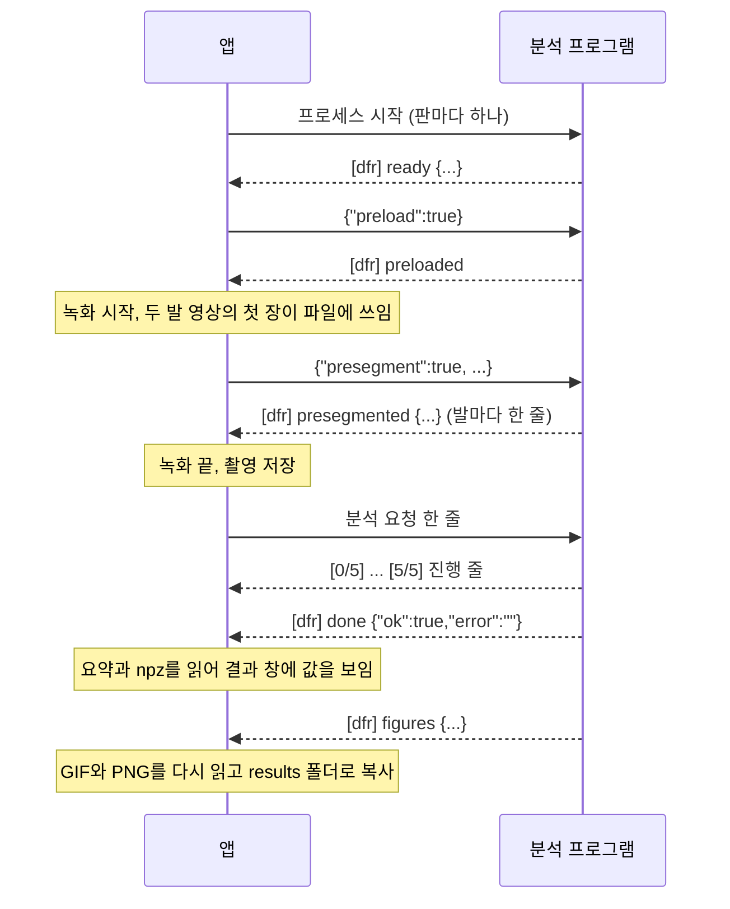

# 관류 분석 연동 약속

<mark>**앱과 관류 분석 프로그램은 서로의 코드를 읽지 않고, 표준 입력의 JSON 한 줄, 표준 출력의 줄, 결과 파일로만 주고받습니다.**</mark> 이 문서는 그 형식과 규칙의 원본이고, 근거 코드는 `platform/src/analyzer.cc`, `perfusion_analysis.cc`, `perfusion_summary.cc`, `perfusion_detail.cc`, `npy_archive.cc`와 `app/src/analysis_*.cc`입니다.

- **관류 분석 프로그램은 이 레포에 없습니다**<br>앱은 빌드할 때 `HWLAB_ANALYZER_DIR`로 분석 프로그램 폴더를 받아 설치하고, 비워 두면 분석 없이 빌드합니다. 분석 프로그램이 없으면 앱은 분석 칸에 "관류 분석 프로그램 없음"을 보이고 촬영은 그대로 합니다
- **이 문서에서 "앱"은 촬영 앱이고 "분석 프로그램"은 관류 분석 프로그램입니다**<br>좌우(왼발, 오른발, `left`, `right`)는 모두 피험자 기준입니다
- **분석 판은 분석 프로그램 폴더의 `variants/<판>` 하나입니다**<br>앱은 판마다 분석 프로그램을 하나씩 띄우고, 판마다 결과 폴더가 따로 있습니다
- **시험용 가짜 분석 프로그램이 `platform/test/fake_analyzer.cc`에 있습니다**<br>platform 시험이 이 문서의 줄 형식을 가짜 분석 프로그램으로 확인합니다

## 1. 흐름

앱은 분석 프로그램을 앱이 켜질 때 띄워 두고, 촬영이 저장될 때마다 분석 요청을 한 줄 보냅니다.



- **분석 프로그램은 요청을 받은 순서대로 한 건씩 처리합니다**<br>분석 중에는 표준 입력을 읽지 않습니다. 분석 중에 받은 presegment 요청은 그 분석이 끝난 뒤 읽습니다
- **대기열은 앱에 있습니다**<br>앱은 분석 요청 한 건의 완료 줄을 받은 뒤에 다음 분석 요청을 보냅니다
- **안정화와 녹화 중에는 preload와 분석 요청을 보내지 않습니다**<br>모델 파일 읽기가 영상 쓰기와 디스크를 나눠 쓰지 않게 하기 위함입니다. presegment 요청만 녹화 중에 보냅니다. 판이 여럿이면 앞 판의 분석이 끝날 때까지 뒤 판의 요청도 보내지 않습니다

## 2. 분석 프로그램 찾기와 띄우기

<mark>**앱은 실행 파일 폴더의 파이썬으로 `analysis/dfr_worker.py`를 판마다 하나씩 띄우고, 앱이 닫힐 때까지 둡니다.**</mark>

```text
<앱 폴더>/                              앱 실행 파일(hwlab_app)이 있는 폴더
  python/python.exe                     Windows. 다른 OS는 python/bin/python3
  analysis/dfr_worker.py                분석 프로그램
  analysis/variants/<판>/VARIANT.json    판 정보
```

빌드할 때 `HWLAB_ANALYZER_DIR`(`dfr_worker.py`가 있는 폴더)를 주면 `cmake --install`이 그 폴더를 `bin/analysis`로 설치하고, `HWLAB_PYTHON_DIR`(`python.exe`가 있는 폴더)를 주면 `bin/python`으로 설치합니다. `HWLAB_ANALYZER_DIR`을 줬는데 그 폴더에 `dfr_worker.py`가 없으면 구성 단계에서 멈춥니다.

앱이 쓰는 명령줄은 다음과 같습니다. 인자 순서도 이와 같습니다.

```text
<앱 폴더>/python/python.exe <앱 폴더>/analysis/dfr_worker.py --idle-exit 0 --presegment-threads 2 --prestream --variant <판>
```

| 항목 | 값 |
| --- | --- |
| 작업 폴더 | `dfr_worker.py`가 있는 폴더 |
| 더하는 환경 변수 | `PYTHONUNBUFFERED=1`, `PYTHONUTF8=1`, `PYTHONIOENCODING=utf-8` |
| 우선순위 | 낮춤 (Windows `BELOW_NORMAL_PRIORITY_CLASS`) |
| 표준 오류 | 표준 출력과 합쳐 한 스트림으로 읽음 |
| 시스템 PATH의 파이썬 | 쓰지 않음 |

- **띄우기 전에 파이썬과 스크립트 파일이 있는지 봅니다**<br>둘 중 하나가 없거나 크기가 0이면 앱은 분석 프로그램을 띄우지 않고 "관류 분석 프로그램 없음"을 보입니다
- **개발할 때는 파이썬과 스크립트 경로를 바꿀 수 있습니다**<br>앱 인자 `--analyzer-python <실행 파일>`, `--analyzer-script <스크립트>`로 둘을 바꿉니다. 판은 바꾼 스크립트가 있는 폴더의 `variants/`에서 찾습니다
- **`--variant <판>`은 꼭 줍니다**<br>없거나 `variants/`에 없는 판이면 분석 프로그램은 준비 줄을 찍기 전에 끝납니다
- **`--idle-exit 0`이면 스스로 끝나지 않습니다**<br>0보다 크면 요청 없이 그 시간(초)이 지난 뒤 `[dfr] idle-exit`을 찍고 끝납니다. 앱은 촬영마다 모델을 다시 올리지 않도록 늘 0을 줍니다
- **`--presegment-threads 2 --prestream`은 녹화 중 미리 계산을 켭니다**<br>앱 인자 `--no-prestream`을 주면 두 인자를 빼고 띄웁니다. 앱 인자 `--presegment-threads <수>`로 스레드 수를 바꿀 수 있습니다. 결과 값은 미리 계산을 켜든 끄든 같고 걸리는 시간만 다릅니다

### 2.1 판 찾기

앱은 `<스크립트 폴더>/variants/*/VARIANT.json`을 읽어 판을 찾습니다. `id`가 폴더 이름과 같은 것만 판으로 보고, 판 이름 순서로 판마다 프로세스를 하나씩 띄웁니다. 판이 하나도 없으면 `--variant` 없이 하나를 띄워, 분석 프로그램이 끝나며 남긴 이유가 분석 칸에 보이게 합니다.

| 키 | 형식 | 앱이 쓰는 곳 |
| --- | --- | --- |
| `id` | 문자열, 폴더 이름과 같음 | `--variant` 값, 결과 폴더 이름 |
| `label` | 문자열 | 판 탭 이름. 없으면 `id` |
| `summary` | 문자열 | 판 설명 한 줄 |
| `upstream.commit`, `upstream.date` | 문자열 | 판 출처 표시 |
| `release.tag` | 문자열 | 판 출처 표시 |
| `release.classifier`, `release.template` | 객체(`name`, `sha256`, `uploaded`) | 판 출처 표시 |

## 3. 줄 형식

<mark>**표준 입력과 표준 출력은 BOM 없는 UTF-8이고, 한 줄에 메시지 하나입니다.**</mark>

- **앱이 쓰는 줄은 `\n`으로 끝납니다**<br>한글 경로는 이스케이프하지 않고 UTF-8 그대로 씁니다. JSON 이스케이프는 `"`, `\`, 제어 문자만 합니다
- **분석 프로그램의 줄은 `\n` 또는 `\r\n`으로 끝납니다**<br>앱은 줄 끝의 `\r`을 뗍니다
- **앱은 표준 입력에 BOM을 쓰지 않습니다**<br>분석 프로그램(파이썬 `json.loads`)은 BOM이 붙은 줄을 읽지 못하고 실패 완료 줄로 답합니다. 그 줄이 첫 줄인 preload이면 앱은 preloaded를 받지 못하고 180초 뒤 분석 프로그램을 실패로 둡니다

## 4. 앱이 보내는 줄

| 줄 | 보내는 때 | 답 |
| --- | --- | --- |
| `{"preload":true}` | 준비 줄을 받은 뒤 보류가 아닐 때 한 번 | `[dfr] preloaded` 또는 `[dfr] preload-failed <이유>` |
| `{"presegment":true,"left_video":...,"right_video":...}` | 녹화 중 두 발 영상의 첫 장이 파일에 쓰였을 때 | 발마다 `[dfr] presegmented {...}` |
| 분석 요청 | 촬영을 저장하고 분석 입력 확인을 통과했을 때 | 진행 줄, `[dfr] done {...}` |

- **분석 요청은 preload의 답을 받은 뒤에만 보냅니다**<br>preload-failed도 답으로 봅니다. 분석이 모델을 다시 올리므로 요청을 막지 않습니다
- **presegment 요청은 보류와 대기열을 거치지 않습니다**<br>preload의 답을 받은 뒤에만 보내고, 답을 기다리지 않습니다. 완료 줄은 오지 않습니다

### 4.1 분석 요청

앱이 보내는 요청 한 줄의 예입니다(읽기 쉽게 줄을 나눴지만 실제로는 한 줄입니다).

```json
{"rec_dir":"D:/DiabeticFoot/홍길동_19551103/A/20261104_102528",
 "left_video":"D:/DiabeticFoot/홍길동_19551103/A/20261104_102528/20261104_102528_left.mkv",
 "right_video":"D:/DiabeticFoot/홍길동_19551103/A/20261104_102528/20261104_102528_right.mkv",
 "left_frames":900,"right_frames":900,
 "output":"D:/DiabeticFoot/홍길동_19551103/A/20261104_102528/perfusion/v10",
 "name":"20261104_102528","cuff_side":"none","template":"v106w",
 "classify":true,"pad_classifier":false,"gif":true,"defer_figures":true}
```

| 키 | 형식 | 앱이 보내는 값 | 필수 |
| --- | --- | --- | --- |
| `rec_dir` | 문자열 | 촬영 폴더 | 예 |
| `left_video`, `right_video` | 문자열 | 두 발 영상 경로 | 둘 다 주거나 둘 다 뺌 |
| `left_frames`, `right_frames` | 정수 | 사이드카의 `frames.written` | 아니오 |
| `output` | 문자열 | `<촬영 폴더>/perfusion/<판>` | 예 |
| `name` | 문자열 | 촬영 폴더 이름 | 아니오 |
| `cuff_side` | 문자열 | `none` | 아니오 |
| `template` | 문자열 | `v106w` | 아니오 |
| `classify` | 참거짓 | `true` | 아니오 |
| `pad_classifier` | 참거짓 | `false` | 아니오 |
| `gif` | 참거짓 | `true` | 아니오 |
| `defer_figures` | 참거짓 | `true` | 아니오 |

- **앱은 요청을 촬영 폴더의 매니페스트로 만듭니다**<br>`<촬영 폴더>/<폴더 이름>_shot.json`의 `files.left_video`, `files.right_video`가 영상 이름이고, `files.left_sidecar`, `files.right_sidecar`의 `frames.written`이 장 수입니다
- **영상 경로를 빼면 분석 프로그램은 `rec_dir`의 `left.avi`, `right.avi`를 씁니다**<br>기존 앱의 폴더 구조입니다. 지금 앱은 늘 경로를 줍니다
- **장 수를 주면 분석 프로그램이 영상 머리글의 장 수와 비교합니다**<br>다르면 분석하지 않고 실패로 답합니다
- **`name`이 결과 파일 이름의 앞부분입니다**<br>비우면 분석 프로그램이 `<rec_dir의 부모 폴더 이름>_<rec_dir 폴더 이름>`으로 짓습니다. 앱은 요약 경로를 `<output>/<name>_summary.json`으로 정하므로 늘 `name`을 줍니다
- **`cuff_side`를 비우면 분석 프로그램이 정합니다**<br>기본은 `left`입니다. 앱은 `none`을 보냅니다
- **`classify`가 false이거나 `template`이 `v106w`가 아니면 요약의 `cuff_level`이 null입니다**
- **`pad_classifier`가 true이면 분석하지 않고 실패로 답합니다**<br>이 판정에 쓰는 모델은 배포 패키지에 없습니다
- **`defer_figures`가 true이면 그림을 완료 줄 뒤에 그립니다**<br>요약과 npz를 쓴 뒤 `[dfr] done`을 찍고, PNG와 GIF를 다 그리면 `[dfr] figures`를 찍습니다. false이면 그림까지 그린 뒤 `[dfr] done`을 찍고 figures 줄은 없습니다
- **`gif`가 false이면 GIF를 만들지 않습니다**<br>PNG는 그대로 그립니다

## 5. 분석 프로그램이 내는 줄

<mark>**앱은 `[dfr] `로 시작하는 줄과 줄 맨 앞의 `[n/m]` 줄만 해석하고, 나머지 줄은 기록 파일에만 남깁니다.**</mark>

| 줄 | 찍는 때 | 앱의 처리 |
| --- | --- | --- |
| `[dfr] ready {JSON}` | 요청을 받을 준비가 됨 | preload를 보냄 |
| `[dfr] preloaded` | 모델을 올림 | 요청을 보내기 시작 |
| `[dfr] preload-failed <이유>` | 모델을 올리지 못함 | preloaded와 같음 |
| `[n/m] <문구>  [<초> s]` | 진행 단계 시작 | 진행 막대, 시간 제한 갱신 |
| `  [k/n] <문구>  (<초> s)` | 하위 단계 시작 | 진행 막대 안 세부 |
| `[dfr] done {JSON}` | 요청 한 건이 끝남 | 성공, 실패 판정 |
| `[dfr] figures {JSON}` | 미룬 그림을 다 그림 | 그림 다시 읽기, results 복사 |
| `[dfr] presegmented {JSON}` | 첫 장 미리 분할이 끝남 | 줄 수를 셈 |
| `[dfr] prestreamed {JSON}` | 녹화 중 미리 읽기가 끝남 | 기록만 |
| `[dfr] stamp-failed <이유>` | 요약에 `dfr` 항목을 붙이지 못함 | 기록만 |
| `[dfr] idle-exit` | 쉬다가 스스로 끝남 | 다시 띄움 |
| 그 밖의 줄 | 분석 코드의 글, 예외 기록 | 기록만 |

- **준비 줄의 JSON은 `variant`, `upstream_commit`, `worker_version`을 담을 수 있습니다**<br>앱은 `worker_version`과 `upstream_commit`을 읽어 상태에 둡니다. JSON이 없거나 읽지 못해도 준비가 된 것으로 봅니다
- **진행 줄은 0번째 칸에서 시작하는 `[n/m]`입니다**<br>n과 m은 1~6자리 숫자이고 m > 0, n ≤ m입니다. 앞에 공백이 있으면 하위 단계입니다. 줄 끝에 공백과 괄호로 붙은 경과 시간(`[12 s]`, `(0 s)`)은 괄호 안이 숫자, `.`, `s`, 공백뿐일 때 앱이 뗍니다
- **완료 줄의 JSON은 값이 모두 문자열, 숫자, 참거짓, null인 객체 하나입니다**<br>앱의 읽기는 값에 객체나 배열이 있으면 줄 전체를 읽지 못하고 실패로 봅니다. `error`는 여러 줄일 수 있습니다(`\n` 이스케이프). 앱은 실패 문장의 앞 세 줄, 240자까지만 화면에 보입니다
- **figures 줄의 JSON은 `ok`, `error`, `seconds`입니다**<br>앱은 `ok`를 보지 않고 줄이 온 것만 봅니다. 완료 줄 뒤 30초 안에 figures 줄이 없으면 기다리지 않고 results 폴더로 복사합니다
- **presegmented 줄은 발마다 하나입니다**<br>성공이면 `{"video": <경로>, "ok": true, "waited_s": <초>, "seconds": <초>, "found": <참거짓>}`, 실패이면 `ok`가 false이고 `error`(문장)와 `reason`(코드)이 있습니다. presegment가 꺼져 있거나 모델이 아직 없으면 `video` 없이 실패 줄 하나만 찍습니다. 앱은 줄 수와 마지막 줄만 상태에 둡니다
- **요청을 보낸 때부터 끝날 때까지 받은 줄을 모두 기록 파일에 남깁니다**<br>앱이 `<output>/analyzer_log.txt`에 덧붙입니다. 보낸 요청 줄은 `> `, 앱이 정한 실패 이유는 `! `를 앞에 붙입니다

### 5.1 진행 단계

분석은 `[0/5]`부터 `[5/5]`까지 여섯 줄을 찍고, 하위 단계 줄은 찍지 않습니다. m이 5이면 앱은 문구 대신 다음 이름을 보입니다.

| 번호 | 앱이 보이는 이름 | 시작 비율 |
| --- | --- | --- |
| 0 | 분석 모델 준비 | 0 |
| 1 | 영상 읽기와 발 찾기 | 0 |
| 2 | 맥박 신호 추출 | 0.62 |
| 3 | 관류 계산 | 0.85 |
| 4 | 커프 단계 추정 | 0.87 |
| 5 | 결과 파일 저장 | 0.92 |

시작 비율은 남은 시간을 예상하는 데만 씁니다. m이 5가 아니면 앱은 문구를 그대로 보이고 진행 비율을 단계 수로 나눕니다.

## 6. 앱의 시간 제한과 다시 띄우기

<mark>**앱은 진행 줄이 180초 동안 없으면 분석 프로그램을 강제 종료하고, 그 요청을 실패로 둔 뒤 다시 띄웁니다.**</mark> 하위 단계 줄도 진행으로 셉니다. 값 180초는 `AnalyzerTiming::stage_timeout_ms`입니다.

| 경우 | 앱이 하는 일 |
| --- | --- |
| 준비 줄이 180초 안에 없음 | 강제 종료, 실패 상태 |
| preload의 답이 180초 안에 없음 | 강제 종료, 실패 상태 |
| 준비 전에 끝남 | 실패 상태, 이유에 종료 코드와 마지막 출력 6줄을 넣음 |
| 분석 중 진행 줄이 180초 동안 없음 | 강제 종료, 그 요청 실패, 다시 띄움 |
| 분석 중 끝남 | 그 요청 실패, 다시 띄움 |
| 대기 중 끝남 (idle-exit 포함) | 다시 띄움 |
| 사용자가 분석을 취소 | 강제 종료, 그 요청 실패, 다시 띄우고 preload |
| 앱을 닫음 | 표준 입력을 닫고 3초 기다린 뒤 강제 종료. 분석 중이면 바로 강제 종료 |

- **실패 상태에서는 저절로 다시 띄우지 않습니다**<br>준비 전에 끝난 분석 프로그램은 다시 띄워도 같은 이유로 끝나기 때문입니다. 다음 분석 요청이나 사용자의 다시 시도에서 다시 띄웁니다
- **다시 띄워도 대기열의 요청은 남습니다**<br>다시 띄운 분석 프로그램이 준비되면 이어서 보냅니다
- **분석 프로그램은 표준 입력이 닫히면 종료 코드 0으로 끝납니다**

## 7. 결과 파일

<mark>**분석 프로그램은 `<촬영 폴더>/perfusion/<판>/`에 `<name>_`으로 시작하는 파일을 쓰고, 앱은 그중 일곱 개를 읽습니다.**</mark>

| 파일 | 없을 때 | 앱이 쓰는 곳 |
| --- | --- | --- |
| `<name>_summary.json` | 분석 실패 | 결과 창의 숫자, 측정 품질 안내 |
| `<name>_perfusion.npz` | 그래프와 지도 없음 | 시간 창 그래프, 표준 발 PI 지도 |
| `<name>_waveforms.npz` | 맥박을 상대값으로 그림 | 30초 맥박 파형 |
| `<name>_perfusion.gif` | 지도 칸 비움 | 재생 위치를 따르는 관류 지도 |
| `<name>_segmentation.png` | 그림 없음 | "발 분할" 그림 |
| `<name>_template.png` | 그림 없음 | "양발 정합" 그림 |
| `<name>_pi_map.png` | 그림 없음 | "표준 발 PI 지도" 그림 |

- **분석 프로그램은 이 밖의 파일도 씁니다**<br>`<name>_cells.npz`와 다른 PNG입니다. 앱은 읽지 않습니다
- **앱은 결과 일부를 저장 위치의 results 폴더로 복사합니다**<br>`_summary.json`, `_report.txt`, `_perfusion.gif`, `.png`, `_frame_timing.csv`, `_frame_windows.csv`로 끝나는 파일이고, npz는 복사하지 않습니다
- **분석 판을 나누기 전(2026-10-28 이전)의 결과는 `<촬영 폴더>/perfusion/`에 바로 있습니다**<br>결과 창은 이 결과를 "이전 분석" 탭으로 엽니다

### 7.1 시간 창

창 k는 녹화 첫 장에서 k × `window_stride_s`초 뒤에 시작해 `window_s`초 동안이고, 가운데 시각은 k × `window_stride_s` + `window_s` / 2입니다. 지금 분석은 30초 녹화를 10초 창, 2초 간격으로 나눠 창 11개(가운데 5초~25초)를 냅니다.

- **시간 창마다 값이 하나인 배열은 길이가 `n_windows`입니다**<br>`perfusion.npz`의 `time_s`, 창별 PI, GIF의 장이 모두 같은 창 순서입니다
- **결과 창은 재생 위치에서 가운데 시각이 가장 가까운 창을 보입니다**<br>거리가 같으면 앞 창입니다

### 7.2 요약 `<name>_summary.json`

<mark>**요약은 파이썬 `json.dump`가 쓴 JSON이라 숫자 자리에 `NaN`, `Infinity`, `-Infinity`가 올 수 있고, 앱은 이것을 값이 없는 것으로 읽습니다.**</mark>

- **이 세 낱말은 표준 JSON이 아닙니다**<br>엄격한 JSON 읽기 라이브러리는 이 낱말이 있는 문서를 읽지 못하므로, 요약을 읽는 쪽은 이 낱말을 받아야 합니다. 앱은 `platform/src/json_reader.h`의 자체 읽기로 받습니다
- **ASCII 밖 글자는 `\uXXXX`로 옵니다**<br>BMP 밖 글자는 대리쌍 두 개입니다. 줄을 나누고 들여 쓴 여러 줄 JSON입니다
- **앱은 모르는 키를 무시하고, 없는 키는 값이 없는 것으로 둡니다**<br>`pi_left`와 `pi_right`가 없을 때만 요약을 읽지 못한 것으로 봅니다. 두 값이 `NaN`이면 읽은 것이고 값만 없습니다
- **분석 프로그램은 그림을 다 그린 뒤 요약을 한 번 더 바꿔 씁니다**<br>`dfr.timing`에 시간을 더하려고 임시 파일(`<name>_summary.json.tmp`)에 쓴 뒤 이름을 바꿉니다. 앱은 요약 파일을 열어 둔 채로 두지 않습니다. 바꾸지 못하면 분석 프로그램은 `[dfr] stamp-failed`를 찍고 결과 값은 그대로입니다

현재 분석 판의 요약에서 앱이 읽는 키입니다. `<발>`은 `left` 또는 `right`입니다.

| 키 | 형식 | 결과 창 |
| --- | --- | --- |
| `pi_left`, `pi_right` | 숫자(%) | 발별 PI. 필수 |
| `pi_ratio_left_right` | 숫자 | 왼발 PI / 오른발 PI. 없으면 앱이 계산 |
| `per_side.<발>.pi_toes`, `pi_fore`, `pi_mid`, `pi_heel` | 숫자(%) | 부위별 PI 막대 |
| `template_corr_lr` | 숫자(-1~1) | 좌우 맥박 상관 |
| `n_windows` | 정수 | 시간 창 수 |
| `window_s`, `window_stride_s` | 숫자(초) | 시간 창 길이, 간격 |
| `fps` | 숫자 | 분석한 영상 fps |
| `n_frames` | 정수 | 분석한 장 수 |
| `n_light_ref_min` | 정수 | 조명 기준 블록 수. 0이면 이상으로 보임 |
| `foot_cells.used`, `foot_cells.common` | 정수 | PI 계산 셀 수, 두 발 공통 셀 수 |
| `foot_mask.<발>.method` | 문자열 | 발 영역을 찾은 방법의 이름 |
| `foot_mask.<발>.det_score`, `sam_iou` | 숫자(0~1) | 분할 점수 |
| `foot_mask.<발>.cells` | 정수 | 발 셀 수 |
| `classification` | null | 현재 분석 판은 늘 null |

**커프 단계 `cuff_level`** 은 객체 또는 null입니다. <mark>**`cuff_level.applicable` 키가 없으면 앱은 커프 단계 전체를 없는 것으로 봅니다.**</mark>

| 키 | 형식 | 결과 창 |
| --- | --- | --- |
| `applicable` | 참거짓 | 필수. 고정 카메라 설정으로 찍었으면 true |
| `level` | `"0"`, `"V"`, `"D"`, `"O"`, null | 커프 상태. null이면 측정 품질 부족 |
| `level_ko` | 문자열 | 상태 이름 |
| `level_if_quality_ignored` | 상태 문자 | 품질 검사를 뺐을 때의 상태 |
| `pad` | 참거짓, null | 고른 상태가 D 또는 O이면 true |
| `pad_probability` | 숫자(0~1) | PAD 확률 |
| `state_probabilities.0`, `.V`, `.D`, `.O` | 숫자(0~1) | 네 상태의 확률 |
| `quality_ok` | 참거짓 | false이면 단계를 내지 않은 이유를 보임 |
| `rule` | 문자열 | 비어 있지 않으면 판정 줄과 품질 줄을 보임 |
| `features.hi_snr1_30` | 숫자(dB) | 강한 발의 맥박 신호대잡음비 |
| `quality_snr_db` | 숫자(dB) | 품질 검사 기준 |
| `setting.mode` | `manual`, `auto` | 촬영 카메라 노출 방식 |
| `setting.exposure_step`, `setting.gain` | 숫자 | 촬영 카메라 노출 단계, 게인 |

**측정 품질 `qc`** 는 객체 또는 null입니다. 앱은 `qc.status`가 비어 있지 않은 문자열일 때만 읽고, `items`를 받은 순서대로 보입니다.

| 키 | 형식 | 결과 창 |
| --- | --- | --- |
| `status` | `ok`, `check`, `retake` | 촬영 화면과 결과 창의 상태 |
| `status_ko`, `action_ko` | 문자열 | 상태 문장, 조치 문장 |
| `items[].code` | 문자열 | 항목 코드 |
| `items[].name_ko` | 문자열 | 항목 이름 |
| `items[].severity` | `ok`, `warn`, `fail`, `na` | 항목 상태 |
| `items[].value` | 문자열 또는 숫자 | 값 |
| `items[].unit`, `threshold`, `message_ko`, `action_ko` | 문자열 | 단위, 기준, 경고, 조치 |
| `items[].reason` | `equipment`, `subject`, `posture`, `other`, null | 측정 실패 사유 |
| `thermal_contrast.left`, `.right` | 숫자 | 발마다 열화상 대비 |

- **`pulse_timing` 항목의 값 세 개는 앱이 한국어로 바꿉니다**<br>`contact PPG`는 "손가락 PPG", `v106w-foot left`는 "왼발 영상", `v106w-foot right`는 "오른발 영상"입니다
- **단위가 `counts`이면 값 뒤에 단위를 붙이지 않습니다**

**`dfr`** 은 분석 프로그램이 결과 뒤에 덧붙이는 항목입니다.

| 키 | 형식 | 결과 창 |
| --- | --- | --- |
| `variant` | 문자열 | 결과를 낸 판 |
| `upstream_commit` | 문자열 | 판 고르기 줄의 출처 표시 |
| `presegment.enabled` | 참거짓 | false이면 미리 분할을 켜지 않음 |
| `presegment.reason` | 코드, null | 미리 분할 결과를 쓰지 못한 이유 |
| `prestream.enabled` | 참거짓 | false이면 미리 읽기를 켜지 않음 |
| `prestream.used`, `prestream.reason` | 참거짓, 코드 | 미리 읽은 값을 썼는지, 못 쓴 이유 |
| `timing` | 객체 | 단계별 시각. 앱은 읽지 않음 |

이유 코드는 다음 중 하나입니다. 어느 코드든 결과 값은 같고 분석 시간만 길어집니다.

| 코드 | 키 | 경우 |
| --- | --- | --- |
| `model_not_loaded` | presegment | 녹화 시작 때 분할 모델이 아직 없었음 |
| `first_frame_unreadable` | 둘 다 | 녹화 중인 영상의 첫 장을 읽지 못함 |
| `not_requested` | presegment | 이번 녹화의 presegment 요청이 오지 않음 |
| `first_frame_mismatch` | presegment | 미리 분할한 첫 장과 저장된 첫 장이 다름 |
| `error` | 둘 다 | 그 밖의 예외 |
| `not_started` | prestream | 이번 녹화의 미리 읽기가 시작되지 않음 |
| `file_not_created` | prestream | 20초 안에 영상 파일이 생기지 않음 |
| `open_failed` | prestream | 녹화 중인 영상을 열지 못함 |
| `not_30fps` | prestream | 영상 fps가 30이 아님 |
| `no_presegment` | prestream | 첫 장의 미리 분할 결과가 없음 |
| `cancelled` | prestream | 다음 녹화가 시작되어 멈춤 |
| `frame_count_mismatch` | prestream | 미리 읽은 장 수가 분석할 장 수와 다름 |
| `verify_failed` | prestream | 미리 읽은 값이 저장된 영상과 다름 |

**옛 결과에만 있는 키**도 앱은 읽습니다. 옛 결과를 결과 창에서 여는 기능을 유지하기 때문입니다. 현재 분석 프로그램은 이 키를 쓰지 않습니다. 키 이름은 `platform/include/hwlab/platform/perfusion_summary.h`에 있습니다.

- **커프 압력 단계(v8까지)**<br>수축기 혈압 대비 퍼센트 단계(`cuff_level.level_pct_sbp`)와 그 계산 값, 규칙 판정의 지표와 기준 값(`features.*`, `thresholds.*`), 숫자인 `level_if_quality_ignored`입니다
- **커프 상태 문자 `M`, `S`**<br>앱은 둘 다 폐색(`O`)으로 보입니다
- **이진 PAD 판정**<br>`classification` 아래의 판정 확률, 기준, 결정, 구간별 값과 `dfr.thermal_skipped`입니다
- **발 블록 수(v7까지)**<br>`foot_mask.<발>.blocks`

### 7.3 `<name>_perfusion.npz`

<mark>**이름이 `_left`나 `_right`로 끝나는 숫자 배열은 두 템플릿을 빼고 모두 길이가 `n_windows`인 1차원 배열이어야 하고, 하나라도 다르면 앱은 이 파일 전체를 읽지 못한 것으로 봅니다.**</mark> 앱은 이런 배열을 이름에서 `_left`, `_right`를 뗀 지표로 모두 읽으므로, 다른 모양의 배열을 이 파일에 더하면 결과 창의 그래프가 모두 사라집니다.

| 배열 | dtype | 모양 | 필수 |
| --- | --- | --- | --- |
| `time_s` | `<f8` | (창) | 예 |
| `template_left`, `template_right` | `<f8` | (장) | 예, 길이가 같음 |
| `fps` | `<f8` | () | 아니오 |
| `template_corr` | `<f8` | (창) | 아니오 |
| `n_light_ref` | `<i8` | (창) | 아니오 |
| `pi_left`, `pi_right` | `<f8` | (창) | PI 그래프에 필요 |
| `pi_toes_<발>`, `pi_fore_<발>`, `pi_mid_<발>`, `pi_heel_<발>` | `<f8` | (창) | 부위 그래프에 넷 다 필요 |
| `maps` | `<f8` | (2, 창, 40, 15) | 표준 발 지도에 필요 |
| `map_valid` | `<i4` | (40, 15) | 표준 발 지도에 필요 |
| `outline` | `<f8` | (3, 점) | 표준 발 지도에 필요 |

- **값을 구하지 못한 창은 NaN입니다**
- **템플릿은 영상 장마다 값이 하나입니다**<br>가로축(초)은 장 번호 / `fps`이고, `fps`가 없으면 요약의 `fps`, 그것도 없으면 30입니다
- **`maps`는 [발][창][행][열] 순서입니다**<br>발 0이 왼발, 1이 오른발입니다. 행은 발끝(0)에서 뒤꿈치까지 발 길이를 같은 간격으로 나누고, 열은 그 행의 발 폭을 같은 간격으로 나눕니다. `map_valid`가 0인 칸은 NaN입니다
- **`outline`의 세 행은 u, 왼쪽 끝, 오른쪽 끝입니다**<br>u는 발끝 0에서 뒤꿈치 1까지 늘어나고, 두 끝은 발 길이를 1로 둔 가로 위치입니다
- **모양이 맞지 않는 지도 배열은 지도만 비웁니다**<br>`maps`가 (2, 창, 행, 열)이 아니거나 `map_valid`가 (행, 열)이 아니거나 `outline`이 (3, 2 이상)이 아니면, 파일의 다른 값은 읽고 표준 발 지도만 그리지 않습니다
- **지도 색표의 위 끝은 모든 창의 계산 칸 값의 95번째 백분위수입니다**
- **분석이 더 쓰는 배열은 읽지 않습니다**<br>`sides`(`<U5`), `cuff_side`(`<U4`)는 앱의 npz 읽기가 건너뛰고, `template_used`는 앱이 쓰지 않습니다
- **결과 배열 파일은 npz 그대로 둡니다**<br>앱이 `npy_archive.cc`로 직접 읽으므로 분석 프로그램의 저장 형식을 바꾸지 않습니다

### 7.4 `<name>_waveforms.npz`

| 배열 | dtype | 모양 | 값 |
| --- | --- | --- | --- |
| `fps` | `<f8` | () | 영상 fps |
| `ac_left`, `ac_right` | `<f8` | (장) | 조명 보정한 밝기 변화(DC 대비 %) |
| `pulse_left`, `pulse_right` | `<f8` | (장) | 심박 성분(DC 대비 %) |
| `pi_left`, `pi_right` | `<f8` | () | 녹화 전체로 구한 30초 PI(%) |

- **네 파형이 모두 있고 `pulse_left`와 `pulse_right` 길이가 같을 때만 씁니다**<br>아니면 결과 창은 `perfusion.npz`의 템플릿을 상대값으로 그립니다
- **30초 PI는 시간 창 PI의 평균과 다를 수 있습니다**<br>녹화 전체에서 한 번 구한 값이기 때문입니다

### 7.5 GIF와 PNG

- **GIF는 시간 창마다 한 장이고, k번째 장이 창 k입니다**<br>장 수가 `n_windows`와 같아야 합니다. 결과 창은 장마다 적힌 시간을 쓰지 않고 재생 위치로 장을 고릅니다. 현재 분석은 장마다 800ms, 무한 반복으로 씁니다
- **PNG 세 장은 녹화 전체를 요약한 그림입니다**<br>그림 속 글자는 결과 창 크기에서 읽기 어려워, 앱이 제목 줄에 분할 점수, PI 계산 셀 수, 창 수를 따로 씁니다
- **그림 크기는 정해져 있지 않습니다**

## 8. 앱이 읽는 npz와 npy의 범위

<mark>**앱의 npz 읽기는 `np.savez`가 쓰는 무압축 ZIP만 읽고, `np.savez_compressed`로 쓴 파일은 오류로 봅니다.**</mark> 외부 라이브러리 없이 읽기 위해 받는 범위를 줄였습니다.

| ZIP | 앱의 처리 |
| --- | --- |
| 무압축 항목(방식 0) | 읽음 |
| 압축(deflate 등)이나 암호화된 항목 | 파일 전체 오류 |
| 데이터 기술자가 붙은 항목 | 읽음 (중앙 디렉터리의 크기를 씀) |
| zip64 (크기나 위치가 32비트를 넘음) | 읽음 |
| CRC32가 다른 항목 | 파일 전체 오류 |
| 이름이 `.npy`로 끝나지 않는 항목 | 건너뜀 |
| 끝 레코드 뒤 주석 | 65535바이트까지 읽음 |

| npy | 앱의 처리 |
| --- | --- |
| 머리 버전 1.0, 2.0, 3.0 | 읽음 |
| dtype `<f8`, `<f4`, `<i8`, `<i4` | 읽어 double로 바꿈 |
| 그 밖의 dtype (`<U5`, `\|b1`, `<f2`, 빅 엔디언, 구조체) | 건너뜀 |
| `fortran_order: True`인 2차원 이상 배열 | 건너뜀 |
| 0차원 배열 | 모양이 비었고 값 하나 |
| 데이터 길이가 모양과 다름 | 파일 전체 오류 |

- **배열 이름은 항목 이름에서 `.npy`를 뗀 것입니다**<br>`np.savez`의 키와 같습니다
- **앱이 읽어야 하는 배열은 숫자 dtype 네 개 중 하나로 씁니다**<br>참거짓 배열(`|b1`)은 건너뛰므로, 예를 들어 `map_valid`를 참거짓으로 쓰면 앱은 지도를 그리지 않습니다

## 9. 버전

<mark>**약속에는 버전 번호가 따로 없고, 앱은 키가 있는지로 결과 형식을 가립니다.**</mark>

- **분석 판과 소스 커밋으로 결과의 출처를 압니다**<br>준비 줄의 `variant`, `upstream_commit`과 요약의 `dfr.variant`, `dfr.upstream_commit`입니다. `qc.version`도 있지만 앱은 읽지 않습니다

| 요약에 있는 것 | 앱이 보는 형식 |
| --- | --- |
| 문자인 `cuff_level.level_if_quality_ignored` | 커프 상태 0, V, D, O |
| 숫자인 `cuff_level.level_pct_sbp` | 커프 압력 단계 (v8까지) |
| `foot_mask.<발>.cells` | 발 셀로 PI를 구한 결과 (v8부터) |
| `classification`의 판정 확률과 기준 | 이진 PAD 판정 결과 |
| `dfr.variant`가 없음 | 판을 나누기 전 결과 |

- **앱을 고치지 않아도 되는 변경**<br>요약에 새 키 더하기, 새 출력 줄 더하기(앱은 기록만 함), 준비 줄 JSON에 키 더하기, `perfusion.npz`에 `_left`, `_right`로 끝나지 않는 배열 더하기입니다
- **앱도 같이 고쳐야 하는 변경**<br>앱이 읽는 키의 이름이나 형식 바꾸기, 진행 단계 수 바꾸기, `perfusion.npz`에 시간 창 계열이 아닌 `_left`, `_right` 배열 더하기, 완료 줄 JSON에 객체나 배열 넣기, npz 압축하기, 요청에 새 필수 키 더하기입니다

## 10. 오류

<mark>**분석 프로그램은 분석하지 못한 요청에 `[dfr] done {"ok": false, "error": "<이유>"}`로 답하고 다음 요청을 받습니다.**</mark> 다음은 분석 프로그램이 분석 전에 거절하는 경우와 그 `error` 문장입니다.

- **요청 줄을 JSON으로 읽지 못함 (BOM 포함)**<br>`요청을 읽지 못했습니다: <파이썬 오류>`
- **`rec_dir`나 `output`이 없음**<br>`rec_dir 과 output 이 있어야 합니다.`
- **영상 경로가 한쪽만 있음**<br>`left_video 와 right_video 는 둘 다 주거나 둘 다 빼야 합니다.`
- **영상 파일이 없음**<br>`left 영상이 없습니다: <경로>` (오른발은 `right`)
- **`pad_classifier`가 true**<br>`이 패키지에는 이진 PAD 판정 모델이 없습니다. pad_classifier 를 빼고 요청해 주세요.`
- **영상을 열지 못함**<br>`왼발 영상을 열지 못했습니다: <경로>` (오른발은 `오른발`)
- **영상 머리글의 장 수나 fps가 0 이하**<br>`왼발 영상 머리글의 장 수(n)나 fps(f)가 0 이하입니다. 녹화가 끝까지 저장되지 않았을 수 있습니다.`
- **머리글의 장 수와 실제로 읽히는 장 수가 다름**<br>`왼발 영상 머리글의 장 수(n)가 실제로 읽히는 장 수와 다릅니다.`
- **머리글의 장 수와 요청의 장 수가 다름**<br>`왼발 영상 머리글의 장 수(n)가 녹화 기록의 장 수(m)와 다릅니다.`
- **영상이 가로로 김**<br>`왼발 영상이 가로로 깁니다(WxH). ... 촬영 상자를 세로로 잡아 주세요.`
- **첫 장에서 발을 찾지 못함**<br>`첫 장에서 발을 찾지 못했습니다. 두 발이 발 상자 안에 보이는지 확인해 주세요.`
- **분석 중 그 밖의 예외**<br>파이썬 예외 기록 전체입니다(여러 줄)

앱은 다음 경우도 그 요청을 실패로 봅니다.

- **완료 줄의 JSON을 읽지 못함**<br>"관류 분석 프로그램의 완료 줄을 읽지 못했습니다"
- **완료 줄에 `ok`가 없음**<br>"완료 줄에 ok가 없습니다"
- **`ok`가 false이고 `error`가 비었음**<br>"관류 분석 프로그램이 이유 없이 실패를 알렸습니다"
- **`ok`가 true인데 요약 파일이 없음**<br>"관류 분석 프로그램이 성공을 알렸지만 요약 파일이 없습니다"
- **요약에 `pi_left`나 `pi_right`가 없음**<br>분석은 성공으로 두고, 결과 창이 요약을 읽지 못했다고 보입니다

시간 제한, 비정상 종료, 취소는 [6절](#6-앱의-시간-제한과-다시-띄우기)에 있습니다.

## 11. 분석 프로그램이 촬영 폴더에서 읽는 파일

<mark>**분석 프로그램은 요청의 영상 말고도 `rec_dir`의 녹화 기록 파일을 읽으므로, 앱이 이 파일의 이름이나 형식을 바꾸면 분석 결과가 바뀝니다.**</mark> 파일 형식은 `core/src/record`의 녹화 기록 형식을 따르고, 여기서는 되풀이하지 않습니다.

| 파일 | 분석 프로그램이 쓰는 값 |
| --- | --- |
| `<이름>_shot.json` | 파일 역할별 이름 |
| 발 영상 사이드카 JSON | 카메라 설정(`settings`), 장별 시각 |
| `thermal_left.npy`, `thermal_right.npy` | 측정 품질의 발 온도 항목 |
| `<이름>_ppg.csv` | 손가락 PPG 맥박, 맥박수 비교 |

## 12. 시험

- **platform 시험이 줄 형식과 결과 읽기를 확인합니다**<br>`platform/test/test_perfusion_analysis.cc`는 요청 줄 만들기와 출력 줄 해석, `test_analyzer.cc`는 `fake_analyzer.cc`를 띄워 준비, preload, 분석, 시간 제한, 취소, 판 찾기를 확인합니다
- **결과 파일 읽기는 실제 결과를 고정한 파일로 확인합니다**<br>`test_perfusion_summary.cc`, `test_perfusion_detail.cc`, `test_npy_archive.cc`가 `platform/test/data`의 요약 JSON과 npz를 읽습니다. 이 파일은 분석 프로그램이 낸 결과 값이고 모델 파일은 없습니다
